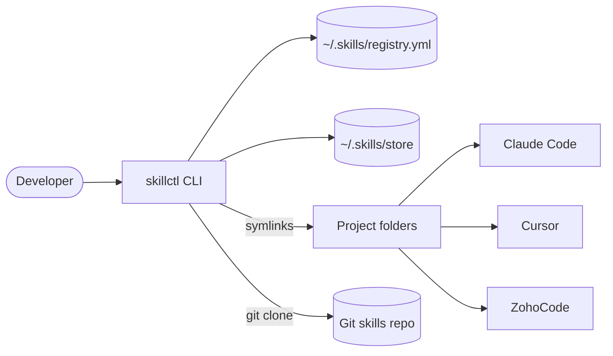
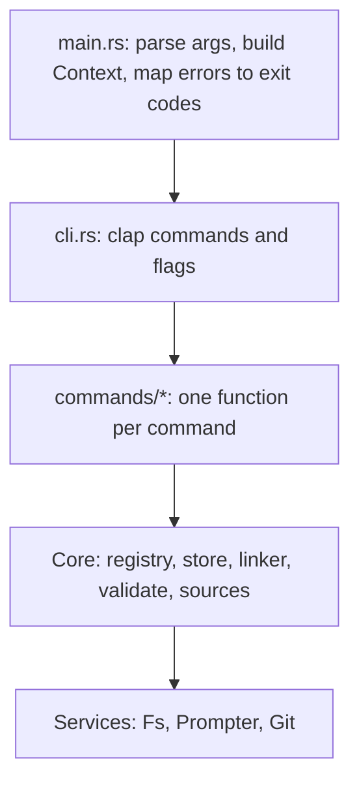
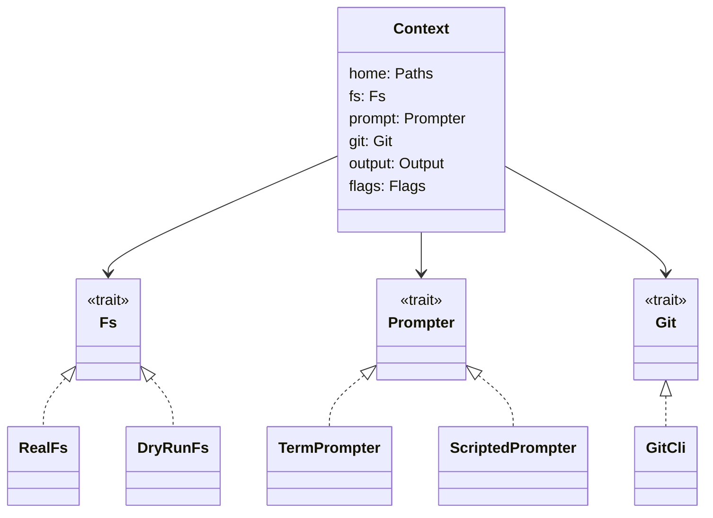

# Architecture

One Cargo package builds a library (`skillctl`) and a thin binary. Commands are plain functions over a `Context` that holds swappable services. Tests and `--dry-run` swap services instead of mocking the OS.

## System overview

## Layers

## Context and swappable services

| Service | Production | Tests / dry run |
|---|---|---|
| `Fs` | `RealFs` | `DryRunFs` records writes instead of performing them |
| `Prompter` | `TermPrompter` (fails with exit 2 if stdin isn't a TTY) | `ScriptedPrompter` (queued answers) |
| `Git` | `GitCli` (shells out to `git`) | Replace `Context.git` with a fake; read-only queries also run during dry runs |

The Git service queries repository roots, absolute per-repository exclude paths (including linked worktrees), and the installed Git version. It requires Git 2.31+ for `--path-format=absolute`. Non-repository and bare-repository folders return no worktree; other Git failures retain stderr and an actionable hint. Commands execute directly without a shell and ignore inherited repository-selection variables so queries describe the requested directory. Context construction does not invoke Git. Clone support remains part of the install work item.

## Modules

| Module | Responsibility |
|---|---|
| `cli.rs` | clap structs for all commands and global flags |
| `context.rs` | Builds `Context`; picks `DryRunFs` when `--dry-run` |
| `error.rs` | `Error` enum, hints, exit-code mapping |
| `names.rs` | Validated `SkillName` / `ProjectName` |
| `paths.rs` | Home resolution, store paths, canonicalize, file identity |
| `registry/` | Registry types, load/save, advisory lock, instance resolution |
| `store/` | Versions, `meta.json`, content hash, staging, drafts |
| `skill/` | `SKILL.md` frontmatter parsing |
| `linker/` | `reconcile()` and Git exclude block |
| `validate/` | Spec, org and harness rules; text/JSON/JUnit reports |
| `sources/` | Install from Git or local folder |
| `services/` | `Fs`, `Prompter`, `Git` traits and impls |

## Instance resolution

`registry::resolve::InstanceResolver` builds a per-command device/inode index of registered instances while the caller holds the registry lock. Missing instance folders are skipped (doctor reports them); other filesystem failures propagate. Resolving canonicalizes the requested folder and walks its ancestors through `/`, returning the owning project and instance at the first identity match, or `None` for an unattached folder. This handles symlink aliases and case-insensitive filesystem aliases without string-prefix comparisons. The implementation uses the existing Unix file-identity helpers, performs no writes, and works unchanged during dry runs. Rebuild the index after registry changes or directory replacement. Command integration follows in the attach/status work item.

## Errors and exit codes

`main.rs` is the only place errors become exit codes.

| Code | Meaning |
|---|---|
| 0 | Success |
| 1 | Command failed |
| 2 | Usage error / missing answer in non-interactive mode |
| 3 | Validation errors |
| 4 | Finished with skipped conflicts |
