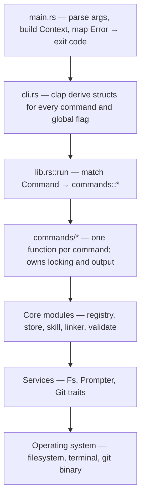
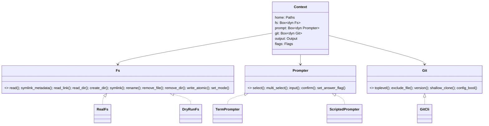
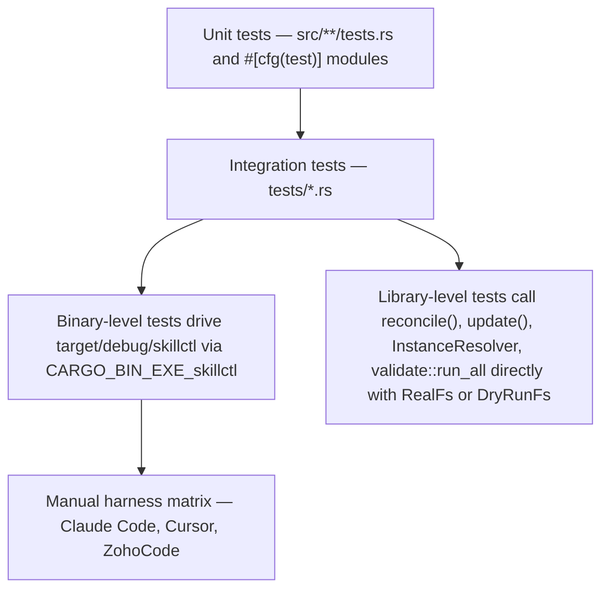
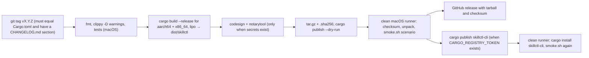

# Architecture

One Cargo package (`edition = "2024"`, `rust-version = "1.85"`) builds a library crate `skillctl` and a thin binary. The binary parses arguments, builds a `Context`, dispatches to a command function, and maps the returned `Error` to a process exit code. Everything else lives in the library so that integration tests and future front-ends can drive the same code.

## Layers



Dependencies only point downward. Core modules never print, never prompt and never decide exit codes; they return typed results and `Error` values. Command functions are the only layer that talks to `Output` and `Prompter`.

## Module map

| Module | Responsibility |
|---|---|
| `cli.rs` | `Cli` (global flags) and the `Command`, `GlobalCommand`, `HookCommand`, `LogCommand`, `AgentCommand`, `ConfigCommand` subcommand enums. Clap validates mutually exclusive flags (`--project`/`--new`, `-q`/`-v`) and parses `SkillName`/`ProjectName` directly where the argument is a bare name. |
| `main.rs` | The only place that converts `Error` into an exit code. Construction failures still honour `--json` and `--quiet`. `Error::ReportedValidation` is mapped to exit 3 without printing a second error, because the validation report has already been written. |
| `lib.rs` | `run(command, &mut Context)`: dispatch table. Commands whose work item is not yet built fall through to `commands::init::ensure_home` and return `Error::NotImplemented`. |
| `error.rs` | The single `thiserror` enum `Error` with a `hint()`, a stable machine-readable `kind()` and an `exit_code()`. |
| `output.rs` | Human and JSON printers over injectable stdout/stderr writers. In `--json` mode results are objects or arrays on stdout and messages go to stderr. |
| `context.rs` | `Context { home, fs, prompt, git, output, flags }` and `Flags { yes, json, dry_run, quiet, verbose }`. `Context::from_cli` picks `DryRunFs` when `--dry-run` is set. Construction resolves paths but never touches the filesystem or invokes Git. |
| `artifact.rs` | `Kind` (`Skill`, `Hook`, `Rule`, `Command`, `Agent`, `Script`): the root document each kind carries (`SKILL.md` / `HOOK.md` / `RULE.mdc` / `COMMAND.md` / `AGENT.md` / `SCRIPT.md`), `linkable()`, `detect`/`of` to read a folder's kind from which document is present (both is an error), serde in lowercase for `meta.json`, and `ValueEnum` for `new --kind`. |
| `eventlog.rs` | `Event` (the fields the `skillctl-logger` hook writes: `ts`, `tool`, `event`, `session`, `skill`, `agent`, `server`, `tool_name`, `test_command`, `trigger`, `harness_version`), `parse`, `read` (a missing or partly written file is an empty or shorter log, never an error) and `span_days`. The one reader of `log/events.jsonl`, used by `artifacts`, `doctor` and `log summary`. |
| `names.rs` | `SkillName` and `ProjectName` newtypes enforcing `^[a-z0-9]+(-[a-z0-9]+)*$`, 1–64 characters. They implement `FromStr`, `Display`, `Serialize`/`Deserialize` and `Ord` so they can key `BTreeMap`s. |
| `paths.rs` | `Paths` (home resolution from `--home`, `SKILLCTL_HOME`, or `~/.skills`; `registry()`, `registry_lock()`, `store()`, `drafts()`, `templates()`), `RelPath` (relative, no `..`, no leading `/`), `HomePath` (`~`-prefixed, expanded at use), canonicalisation and Unix file identity (device + inode). |
| `registry/` | `mod.rs`: `Registry`, `Settings`, `ValidationSettings`, `Global`, `Project`, `Instance`, `Pin`; load, save with backup, load-time invariants. `lock.rs`: advisory `RegistryLock` with shared and exclusive modes. `resolve.rs`: `InstanceResolver`, folder → instance by file identity. |
| `store/` | `mod.rs`: `list_skills`, `list_versions`, `latest_stable`, `store_dir`, `resolve_pin`. `meta.rs`: `Metadata` for `meta.json`. `hash.rs`: canonical `content_hash`. `stage.rs`: `stage_version` and `restore_write_mode`. `drafts.rs`: scaffolding and sealing primitives. |
| `skill/` | `Skill { dir, kind, frontmatter, body }` (the name predates hooks; `load_kind`/`parse_kind` read `HOOK.md` for hooks) and `frontmatter.rs`: splitting the root document on exact `---` lines and parsing YAML into typed known fields plus a map of the rest, where hook fields `events` and `entry` live. |
| `linker/` | `mod.rs`: `Layout`, `LinkPlan` and `plans` (links by artifact kind), `reconcile`, `LinkStatus`, `LinkOutcome`, `ReconcileReport`. `exclude.rs`: per-instance managed block in Git's `info/exclude`. |
| `harness/` | Registration of hooks with the harnesses. `mod.rs`: the constant locations (`~/.claude/hooks` link folder, `~/.claude/settings.json`, `~/.cursor/hooks.json`). `claude.rs`: `load`/`save` of the settings file as generic JSON (missing → `{}`, unparsable → `Error::Usage`, backup to `.bak`, atomic write), `register`/`unregister` of skillctl's entries recognised by their `/.claude/hooks/<name>/` command path, and `registered_events`/`duplicated_events`/`mentions` for `hook list` and `doctor`. |
| `validate/` | `mod.rs`: `Rule` trait, `Finding`, `Severity`, `run`, `run_all` (detects the kind and picks the rule groups), `run_with_rules_kind` (the S001/S002 or K101 gate), suppression and strict policy. `spec.rs`, `org.rs`, `description.rs` (O140–O145), `harness.rs`: skill rule groups; `instructions.rs`: I301–I306/I308/I309 over a project folder's `AGENTS.md`/`CLAUDE.md`/`CLAUDE.local.md`/`.cursor/rules` (`lint`); `hook.rs`: K101–K111 (including `companions`), `rule.rs`: K201–K207, `command.rs`: K301–K305, `agent.rs`: H220–H227, `script.rs`: K501–K507, `rules_for`/`scaffold_rule`/`gate_rules` per kind, reusing `org.rs`'s shared `walk`, `interactive`, `dangerous`, `likely_secret` and `executable` helpers. `fields.rs`: known frontmatter fields per harness. `report.rs`: text, JSON and JUnit renderers. |
| `services/` | `fs.rs`: `Fs` trait, `RealFs`, `DryRunFs`. `prompt.rs`: `Prompter` trait, `TermPrompter`, `ScriptedPrompter`. `git.rs`: `Git` trait and `GitCli`. |
| `sources/` | `mod.rs`: `Source::classify` (existing folder → local, anything else → Git URL) and `discover` (every folder holding `SKILL.md` or `HOOK.md`, recorded with its `Kind`, or only `--path`, never following symlinks or entering dot-folders). `git.rs`: `Checkout`, a shallow clone in a temporary folder that is deleted on drop. |
| `commands/` | `advisory` (directive-description findings and the O143 index budget after pin changes and for `status --budget`), `agent` (`derive`: the Cursor override for an agent draft), `artifacts` (store versions with pins and log usage; `--unused`), `init`, `attach`, `detach`, `status`, `pins` (`add`, `remove`, `relink`, and `reconcile_everything` shared with `doctor --fix` and `config`), `global` (whose `reconcile_into` links any pin map into user-level folders), `hook` (`add`, `remove`, `list`; `declared` reads a stored `HOOK.md` into `Registration`s; `reconcile` links `global.hooks` under `~/.claude/hooks`), `projects`, `skills`, `new`, `edit`, `seal`, `install`, `validate`, `lint` (instruction files, read-only), `log` (`summary`: two windows over the event log with the W29 alerts), `doctor` (with `telemetry` — OpenTelemetry, ccusage, Cursor import evidence and model defaults —, `versions` — harness version drift remembered in `harness-versions.json` —, `mcp`, its advisory audits, and the hook registration checks), `gc`, `config`, `completions`. Shared helpers `read_locked`, `load_registry` and `load_registry_or_default` live in `commands/mod.rs`. |

## Context and swappable services



| Service | Production | Dry run / tests | Notes |
|---|---|---|---|
| `Fs` | `RealFs` | `DryRunFs` | `DryRunFs` reads through to the real filesystem but records every write (`create_dir`, `symlink`, `rename`, `remove_*`, `write_atomic`, `set_mode`) as a planned action instead of performing it. Because reads are real, a dry-run plan reflects the actual disk state. `write_atomic` in `RealFs` writes a temporary file in the same directory, `fsync`s it, and renames it over the target. |
| `Prompter` | `TermPrompter` (dialoguer) | `ScriptedPrompter` | `TermPrompter` honours `--yes` for confirmations only; it never invents answers to selections or inputs. Commands call `set_answer_flag` before each question, so when stdin is not a terminal the resulting `Error::MissingAnswer` names the exact flag that would supply the answer (exit code 2). `ScriptedPrompter` returns queued answers and fails the test if a prompt arrives unexpectedly. |
| `Git` | `GitCli` | any `impl Git` | Shells out to the `git` binary without a shell, clears inherited repository-selection variables (`GIT_DIR` and friends) so queries describe the requested directory, disables terminal credential prompts when stdin is not a terminal, and requires Git ≥ 2.31 for `rev-parse --path-format=absolute --git-path info/exclude`, which returns the right file for linked worktrees. `shallow_clone` runs `git clone --quiet --depth 1 [--branch <ref>]` and returns the checked-out commit; `config_bool` reads a boolean `git config` key (used by `doctor` for `core.symlinks`). Non-repository and bare-repository folders yield `None`; other failures keep stderr and add a hint. |

Commands never call `std::fs` for writes. All mutations, including those in the store and the exclude file, go through `context.fs`, which is what makes `--dry-run` a zero-write guarantee rather than a convention.

## Error and exit-code model

```rust
pub enum Error {
    Usage { message, hint },            // 2
    MissingAnswer { missing, hint },    // 2
    Validation { summary, hint },       // 3
    ReportedValidation,                 // 3, report already on stdout
    Conflicts { summary, hint },        // 4
    Io { operation, source, hint },     // 1
    Registry { message, hint },         // 1
    NotImplemented { command, hint },   // 1
    Doctor { problems, hint },          // 1, report already on stdout
}
```

- Every variant carries a hint naming the next command to run. Text output prints `Error: …` then `Hint: …`; JSON output emits `{ "error", "kind", "hint" }`.
- `kind()` is a stable string (`usage`, `missing_answer`, `validation`, `conflicts`, `io`, `registry`, `not_implemented`, `doctor`) so scripts do not have to parse messages.
- In `--json` mode stdout always holds exactly one document. If a command has already written its result (for example a link report that ends in conflicts and exit 4), the error object goes to stderr instead.
- `ReportedValidation` exists so that `validate --format json|junit` can write exactly one well-formed document and still exit 3; `main.rs` does not print anything further for it.
- Clap owns usage errors, `--help` and `--version`, including in `--json` mode.

## Command anatomy

Every mutating command follows the same shape, which is what makes the registry-first ordering and lock discipline uniform:

```mermaid
sequenceDiagram
    participant Cmd as commands::*
    participant Lock as RegistryLock
    participant Reg as Registry
    participant Core as store / linker
    participant Fs as context.fs
    Cmd->>Cmd: ensure_home (implicit init)
    Cmd->>Lock: open(registry.lock).with_exclusive
    Lock->>Reg: load (schema check, invariants)
    Cmd->>Reg: mutate in memory (pins, instances, settings)
    Cmd->>Reg: save (backup + atomic write)
    Cmd->>Core: reconcile / stage / …
    Core->>Fs: create_dir, symlink, rename, write_atomic
    Core-->>Cmd: report (outcomes, conflicts)
    Cmd->>Reg: save again if created_dirs changed
    Cmd-->>Cmd: print report; Conflicts → exit 4
```

- Read-only commands (`status`, `projects`, `skills`, `global list`, `validate`) use `read_locked`, which takes a shared lock. In dry-run mode no lock is taken, because nothing is written and a missing registry is treated as the default.
- Writers hold the exclusive lock across load, save and reconciliation of every affected instance, so two concurrent `add` runs cannot lose a pin.
- The registry is saved **before** the filesystem is changed. If reconciliation fails halfway, the registry already describes the intended state and `relink` repairs the rest. Newly created directories are saved after reconciliation even on partial failure, so `detach` can still clean them up.

## Test architecture



- Every test sets `SKILLCTL_HOME` (or constructs `Paths`) under a `tempfile` directory and uses explicit temporary global link targets, so no test touches the developer's real store or `~/.claude/skills/`.
- Service traits are the seam: `ScriptedPrompter` drives interactive flows, `DryRunFs` asserts zero writes, and `GitCli::with_program` can point at a fake executable.
- Dry-run coverage snapshots the tree (bytes, modes, symlink destinations) before and after each `--dry-run` invocation and asserts equality.
- CI runs `cargo fmt --check`, `cargo clippy --all-targets --locked -- -D warnings` and `cargo test --locked` on Ubuntu and macOS 14.

## Build and release



- The package is `skillctl-cli` on crates.io (the bare name belongs to an unrelated crate); `[lib]` and `[[bin]]` keep the library and binary named `skillctl`.
- `build.rs` records the commit (`SKILLCTL_COMMIT` in CI, `git rev-parse` locally) so `--version` prints version, commit and the registry schema the binary supports.
- The binary has no runtime dependency other than the system `git`; the release profile uses thin LTO, one codegen unit and symbol stripping.
- `scripts/release/` holds the same steps the workflow runs, so a release can be rebuilt and verified on any Mac: `build-universal.sh`, `sign-and-notarize.sh`, `package.sh`, `smoke.sh`.
