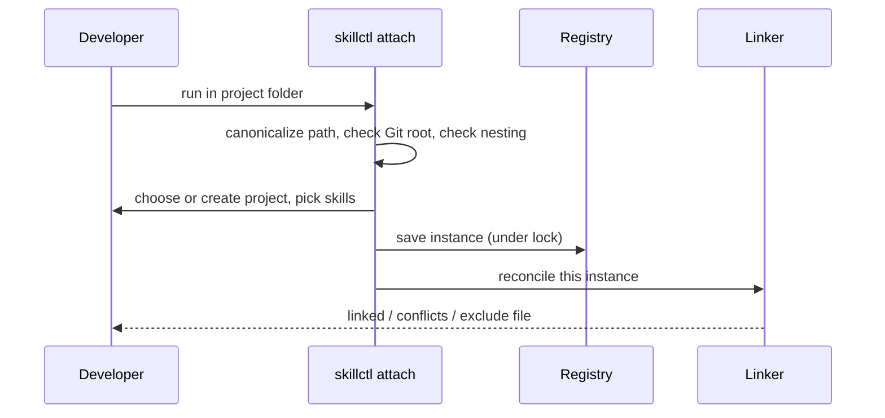
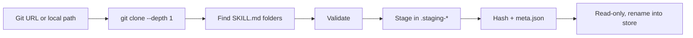
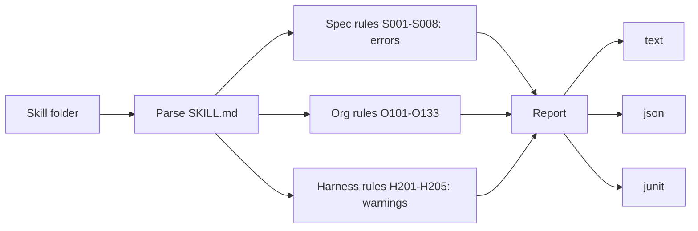

# Commands and Validation

## Global flags

`--home`, `-y/--yes`, `--json`, `--dry-run`, `-q/--quiet`, `-v/--verbose`. Every prompt has a flag; without a TTY and without the answer, the command exits with code 2.

## Commands

| Group | Commands |
|---|---|
| Setup | `init`, `config get/set`, `completions` |
| Projects | `attach`, `detach`, `status`, `projects` |
| Pins | `add`, `remove`, `relink`, `global add/remove/list` |
| Authoring | `new`, `edit`, `seal` |
| Store | `install`, `skills`, `gc` |
| Quality | `validate`, `doctor [--fix]` |

## Attach flow

## Install flow

Same version with same hash reports "already installed".

## Validation

- Rules have stable IDs, severities and fix hints
- `--strict` turns warnings into errors; exit code 3 on errors
- Spec rules can't be disabled; others via `metadata.skillctl-allow` or `settings.validate.allow`

## Doctor checks

Missing instance folders, wrong or dangling links, missing pinned versions, hash mismatches, writable store files, shadowing skills in user folders, `core.symlinks=false`, missing `git`.
