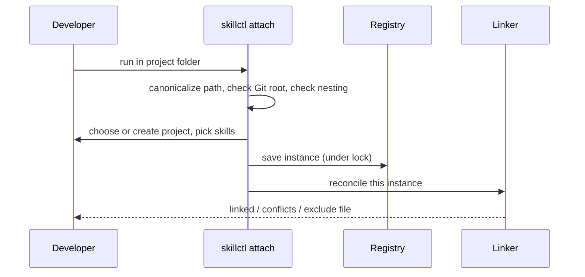
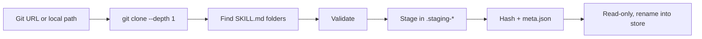
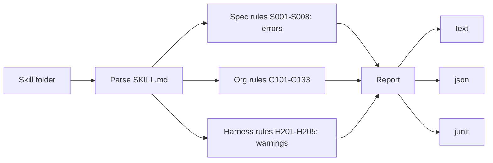

# Commands and Validation

## Global flags

`--home`, `-y/--yes`, `--json`, `--dry-run`, `-q/--quiet`, `-v/--verbose`. Every prompt has a flag; without a TTY and without the answer, the command exits with code 2.

## Commands

| Group | Commands |
|---|---|
| Setup | `init`, `config get/set`, `completions` |
| Projects | `attach`, `detach`, `status`, `projects` |
| Pins | `add`, `remove`, `relink`, `global add/remove/list` |
| Authoring | `new`, `edit`, `seal` |
| Store | `install`, `skills`, `gc` |
| Quality | `validate`, `doctor [--fix]` |

## Implemented authoring, listing and spec validation

- `new <skill> [--from-template <name>]` creates a writable draft, preserves template fields/body, sets its name and version `0.1.0`, and creates empty `scripts/` and `references/` folders. Existing drafts are never replaced.
- `seal <skill> [--bump major|minor|patch]` checks S001–S008 and requires a semver `metadata.version`, stages a read-only version with local-source metadata, then removes the draft only after publication succeeds. A requested bump applies to the stored copy; failed publication leaves the draft unchanged. Org/harness checks will be added in work item 29.
- Both authoring commands hold an exclusive registry lock and support no-write dry runs. `seal --dry-run` never deletes the draft.
- `skills` lists sorted skill/version rows with project usage and global pins. `projects` lists projects and instances, marking missing folders. Both support JSON arrays, quiet output, shared registry locks, and read-only dry runs.
- The native `validate` library now supplies a rule interface, findings, S001–S008 and a text report. Missing documents or malformed frontmatter produce only their prerequisite finding; field errors accumulate. The `validate` CLI and org/harness rules remain work item 29.

## Implemented attachment and status (item 23)

`attach --new <project> --skills demo@1.0.0` creates a project and attaches the canonical current folder; `attach --project <project>` attaches or moves it to an existing project. Interactive mode offers project counts and skill selection. Subfolders of Git repositories offer the repository root. Registry invariants reject nested instances and global/project name clashes before saving. Moves retain created-folder tracking. Desired state is saved before reconciliation; newly created directories are saved even after partial failure. Exclude blocks hide only successfully managed links; conflicts finish with exit 4. Dry runs clone state in memory and route planned writes through the filesystem service.

`status` uses shared locking and identity resolution from any instance subfolder. Text/JSON show project, instance, pins (including drafts), link health and global pins. Outside an instance it prints `Not attached` with success. Status never invokes reconciliation.

## Project pins and relinking (item 24)

`add <skill>[@version] [--project name]` resolves an explicit version or the highest stable store version. `remove <skill> [--project name]` unpins it. Both hold the exclusive lock across load, save and reconciliation of every project instance, so concurrent additions cannot lose changes. Global/project name clashes are rejected. `add --draft` resolves an existing draft. Without `--project`, identity resolution finds the current instance.

`relink` repairs only the current instance; `--project` repairs every instance of that project, and `--all` visits all projects. Conflicts are accumulated and reported with exit 4. Only a successful conflict-free `--all` clears obsolete-target history. Missing pinned content fails explicitly rather than silently changing a pin. Global convergence is added in item 26. Every mode supports zero-write dry runs.

## Attach flow

## Install flow

Same version with same hash reports "already installed".

## Validation

- Rules have stable IDs, severities and fix hints
- `--strict` turns warnings into errors; exit code 3 on errors
- Spec rules can't be disabled; others via `metadata.skillctl-allow` or `settings.validate.allow`

## Doctor checks

Missing instance folders, wrong or dangling links, missing pinned versions, hash mismatches, writable store files, shadowing skills in user folders, `core.symlinks=false`, missing `git`.
