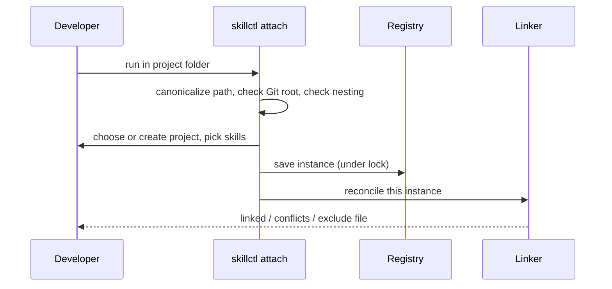
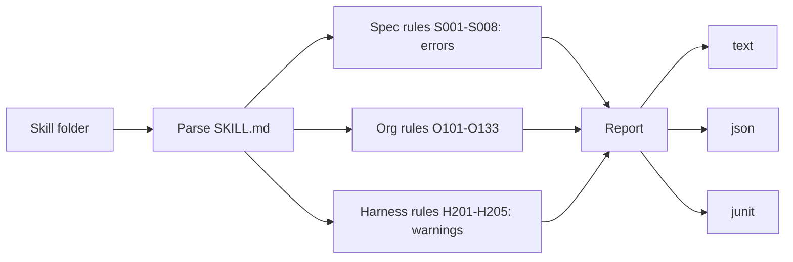

# Commands and Validation

## Global flags

`--home`, `-y/--yes`, `--json`, `--dry-run`, `-q/--quiet`, `-v/--verbose`. Every prompt has a flag; without a TTY and without the answer, the command exits with code 2.

## Commands

| Group | Commands |
|---|---|
| Setup | `init`, `config get/set`, `completions` |
| Projects | `attach`, `detach`, `status`, `projects` |
| Pins | `add`, `remove`, `relink`, `global add/remove/list` |
| Authoring | `new`, `edit`, `seal` |
| Store | `install`, `skills`, `gc` |
| Quality | `validate`, `doctor [--fix]` |

## Implemented authoring, listing and spec validation

- `new <skill> [--from-template <name>]` creates a writable draft, preserves template fields/body, sets its name and version `0.1.0`, and creates empty `scripts/` and `references/` folders. Existing drafts are never replaced.
- `seal <skill> [--bump major|minor|patch]` checks S001–S008 and requires a semver `metadata.version`, stages a read-only version with local-source metadata, then removes the draft only after publication succeeds. A requested bump applies to the stored copy; failed publication leaves the draft unchanged. Full org/harness validation runs before publication; warnings do not block sealing, while unsuppressed errors leave the draft intact.
- Both authoring commands hold an exclusive registry lock and support no-write dry runs. `seal --dry-run` never deletes the draft.
- `skills` lists sorted skill/version rows with project usage and global pins. `projects` lists projects and instances, marking missing folders. Both support JSON arrays, quiet output, shared registry locks, and read-only dry runs.
- The native `validate` library supplies S001–S008 and full org/harness rules. Missing documents or malformed frontmatter produce only their prerequisite finding; field errors accumulate. `run` remains spec-only for backward compatibility; `run_all` runs all groups, combines allow-lists, then applies strict mode.

## Implemented attachment and status (item 23)

`attach --new <project> --skills demo@1.0.0` creates a project and attaches the canonical current folder; `attach --project <project>` attaches or moves it to an existing project. Interactive mode offers project counts and skill selection. Subfolders of Git repositories offer the repository root. Registry invariants reject nested instances and global/project name clashes before saving. Moves retain created-folder tracking. Desired state is saved before reconciliation; newly created directories are saved even after partial failure. Exclude blocks hide only successfully managed links; conflicts finish with exit 4. Dry runs clone state in memory and route planned writes through the filesystem service.

`status` uses shared locking and identity resolution from any instance subfolder. Text/JSON show project, instance, pins (including drafts), link health and global pins. Outside an instance it prints `Not attached` with success. Status never invokes reconciliation.

## Project pins and relinking (item 24)

`add <skill>[@version] [--project name]` resolves an explicit version or the highest stable store version. `remove <skill> [--project name]` unpins it. Both hold the exclusive lock across load, save and reconciliation of every project instance, so concurrent additions cannot lose changes. Global/project name clashes are rejected. `add --draft` resolves an existing draft. Without `--project`, identity resolution finds the current instance.

`relink` repairs only the current instance; `--project` repairs every instance of that project, and `--all` visits all projects. Conflicts are accumulated and reported with exit 4. Only a successful conflict-free `--all` clears obsolete-target history. Missing pinned content fails explicitly rather than silently changing a pin. Global convergence is added in item 26. Every mode supports zero-write dry runs.

## Detach (item 25)

`detach` resolves the current instance (including from subfolders), saves its removal under the exclusive lock, then reconciles against empty pins, removes its exclude block, and removes recorded directories deepest-first only if empty. Real project content, foreign links and directory-chain symlinks are preserved. `--keep-links` skips all filesystem cleanup (including exclude removal); `--delete-project` removes the project only after its last instance leaves. Dry runs leave the registry, links, exclude bytes and folders unchanged.

## Global skills (item 26)

`global add <skill>[@version]`, `global remove <skill>` and `global list` manage user-level pins and per-target link health. Global and project skill names cannot overlap in either direction. Mutations save intended state under the exclusive lock, reconcile user-level targets without Git excludes, and reconcile all project instances when `global_in_instances` is enabled. `relink --all` repairs globals first. The same ownership engine preserves personal skills and reports conflicts with exit 4. Global target directory symlinks resolve before per-skill linking; whole-folder links are never created. Tests use explicit temporary global targets, never the developer's personal folders.

## Attach flow



## Install flow


Same version with same hash reports "already installed".

## Validation



- Rules have stable IDs, severities and fix hints
- `--strict` turns warnings into errors; exit code 3 on errors
- Spec rules can't be disabled; others via `metadata.skillctl-allow` or `settings.validate.allow`

## Full validation (item 29)

```sh
skillctl validate                         # every draft and installed version
skillctl validate demo@1.0.0 --strict --format json
skillctl validate demo@draft
skillctl validate ./skills/demo --format junit > validation.xml
skillctl validate ./skills/demo --with-reference
```

An unversioned name selects the highest stable installed version. Paths are resolved to their real directory. The command holds a shared registry lock and only reads skills; implicit initialization still applies to a missing home. `--dry-run` writes nothing. Warnings exit 0; errors exit 3. Strict mode promotes remaining warnings after suppression. Failure reports remain exactly one JSON array or XML document, without an appended error object. `--format` overrides the global `--json` flag; quiet hides text but preserves machine reports.

- **O101–O104:** semver version, 80-character description, case-insensitive `use when`, no angle brackets.
- **O110–O112:** body line/token budgets and individual reference-file budgets, estimated using Unicode characters ÷ 4.
- **O120–O123:** CommonMark links/images/reference links and backtick resource paths must exist; bundled files must be referenced; no symlinks or `..` references (including percent-encoded traversal). Traversal never follows interior symlinks.
- **O130–O133:** scripts require shebang/executable status; flag interactive input, download-to-shell pipelines and `sudo`; scan every regular file for likely credentials. Secret diagnostics identify a path and line but never echo a value. These are static heuristics, not a sandbox or exhaustive security audit; scripts are never executed.
- **H201–H205:** Claude-only fields, tool permissions, substitutions, forked user interactions and unknown fields. Compatibility lists live in `validate/fields.rs`; manual item 28 remains deferred and defaults provisional.

Suppress only org/harness IDs with `metadata.skillctl-allow: "O102,H201"` or registry YAML `settings.validate.allow: [O102, H201]`. Lists combine; spec findings cannot be suppressed. Existing registries default to an empty allow-list. `seal` uses the same lists under its exclusive lock.

JUnit emits one testcase per skill, including passing skills, and one failure element per error, with escaped locations, hints and a full report in `system-out`. Set a GitLab job's `artifacts:reports:junit` to the redirected XML path. XML is tested locally; live GitLab widget verification still requires a GitLab pipeline.

`--with-reference` runs `skills-ref validate <directory>` if the executable is on PATH. Missing tools are optional. A failed external verdict is merged as error `R001`; native findings remain intact. Raw external output is not copied into reports because its format is not stable and it may disclose secrets. Run the reference command directly for its original details.

## Doctor checks

Missing instance folders, wrong or dangling links, missing pinned versions, hash mismatches, writable store files, shadowing skills in user folders, `core.symlinks=false`, missing `git`.
