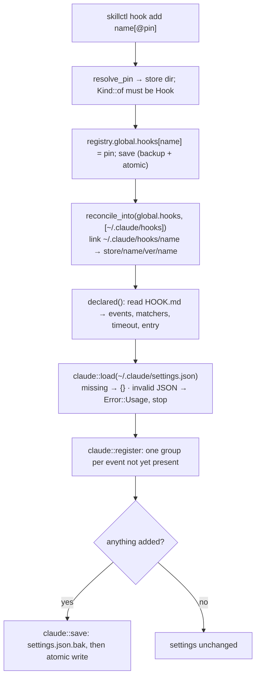

# Hooks

A hook is the second artifact kind in the store: a folder with `HOOK.md` and the script a harness runs on lifecycle events. This page covers how hooks are modelled, how `hook add` registers them, how the same registration reaches Cursor, what the bundled `skillctl-logger` does internally, and what `doctor` checks. Usage (commands, the log format, `jq` recipes) is in the README's [Hooks](https://github.com/abindran/skillctl#hooks) section.

## Artifact model

`artifact::Kind` is `Skill`, `Hook`, `Rule`, `Command`, `Agent` or `Script`. The kind is **detected from the folder**: `SKILL.md`, `HOOK.md`, `RULE.mdc`, `COMMAND.md`, `AGENT.md` or `SCRIPT.md`; more than one is an error (`Kind::detect`). It is also written to `meta.json` as `kind` so listings can read it without opening the folder; a missing `kind` means `skill`, which is how stores created before hooks existed keep working.

Everything else is shared: the same `store/<name>/<version>/<name>/` layout and flat namespace (a skill and a hook cannot share a name), the same content hash, staging, read-only sealing, drafts (`new --kind hook`, `edit`, `seal`), discovery on `install`, and the same `Skill` struct for the parsed document (`Skill { dir, kind, frontmatter, body }`, loaded with `load_kind`).

`HOOK.md` frontmatter:

| Field | Type | Read by |
|---|---|---|
| `name`, `description`, `metadata.version` | as for skills | K102–K104 |
| `events` | list of Claude Code event names | K105/K106, `hook add` |
| `matchers` | map event → tool-name regex | K111, `hook add` |
| `timeout` | seconds, 1–600, default 10 | K111, `hook add` |
| `entry` | script path relative to the folder | K107, `hook add` |
| `companions` | list of artifact names pinned into every project with the hook | K111, `hook add`/`hook remove` |

The hook-specific fields live in the frontmatter's `extra` map rather than typed fields, so skill validation is untouched (a skill with an `events:` key still gets H205). Accessors are in `validate::hook` (`events`, `entry`, `matchers`, `timeout`). Rules K101–K111 are listed on [Validation](Validation#hook-rules).

## Registration flow



The whole command runs under the exclusive registry lock (`pins::write_locked`). Order matters the same way it does for skills: the registry is saved before links and settings are touched, so a crash leaves a pin that `relink --all` or `doctor --fix` can complete.

### The settings merge (`harness::claude`)

`~/.claude/settings.json` is parsed as a generic `serde_json::Value`, never into a typed struct, so every key skillctl does not know about round-trips byte-for-byte in content (formatting is normalised to two-space pretty JSON). The shape Claude Code expects, and the entry skillctl adds:

```json
{
  "hooks": {
    "PostToolUse": [
      { "matcher": "Skill",
        "hooks": [ { "type": "command",
                     "command": "\"$HOME/.claude/hooks/skillctl-logger/hook.py\"",
                     "timeout": 10 } ] }
    ]
  }
}
```

- **Ownership.** An entry is skillctl's when its `command` contains `/.claude/hooks/<name>/`. That substring is the only marker: nothing is written anywhere else in the file, and `unregister` removes exactly the items that carry it, then prunes groups, events and the `hooks` object that became empty.
- **Idempotency.** `register` first collects the events under which the hook already has an entry (`registered_events`). For those it compares the group's `matcher` and the item's `timeout` and `command` with what `HOOK.md` now declares and rewrites only the fields that differ (`updated`), otherwise reports `present`; `save` is not called when nothing changed, which also means no new `.bak`.
- **Why `$HOME` and a link folder.** The command goes through `~/.claude/hooks/<name>/`, a symlink into the store, so upgrading the hook (`hook add name@newer`) repoints one link and never edits `settings.json`. `$HOME` is expanded by the shell the harness uses, which keeps a dotfiles-synced copy of the file portable between machines.
- **Refusals.** A file that fails to parse, or whose top level is not an object, or whose `hooks` key is not an object, is an `Error::Usage` with the reason; nothing is written. This is the price of merging a hand-edited file: skillctl would lose comments or unknown syntax if it rewrote one it could not parse.
- **Backup.** `save` copies the previous bytes to `settings.json.bak` before the atomic write, creating `~/.claude/` if the file did not exist yet (no backup is written in that case).

### Cursor

Cursor loads Claude Code hooks from `~/.claude/settings.json` (and from a project's `.claude/settings.json` and `.claude/settings.local.json`) when **Include Third-Party Plugins, Skills, and Other Configs** is on, which is the default. It translates event names itself:

| `HOOK.md` (Claude Code) | Cursor | Status |
|---|---|---|
| `PreToolUse`, `PostToolUse` | `preToolUse`, `postToolUse` | mapped |
| `UserPromptSubmit` | `beforeSubmitPrompt` | mapped |
| `Stop`, `SubagentStop` | `stop`, `subagentStop` | mapped |
| `SessionStart`, `SessionEnd` | `sessionStart`, `sessionEnd` | mapped |
| `PreCompact` | `preCompact` | mapped |
| `Notification`, `PermissionRequest` | — | not supported |
| everything else | — | Claude Code only |

Matchers and `timeout` carry over; Cursor's `loop_limit` does not apply to imported hooks (it is `null`), which is why a hook that may retry must count its own attempts. Precedence when several sources match is enterprise, team, `.cursor/hooks.json`, `~/.cursor/hooks.json`, Claude project-local, Claude project, Claude user, and **all matching hooks run** — so a hook present in both `~/.claude/settings.json` and `~/.cursor/hooks.json` runs twice in Cursor. skillctl therefore never writes `~/.cursor/hooks.json`, and `doctor` warns when it finds a skillctl hook there.

Whether Cursor rewrites stdin field names to Claude Code's for imported hooks is not documented, so hook scripts should accept both shapes; the logger does.

The setting itself is not stored anywhere skillctl can read (Cursor's `settings.json` has no key for it), so `doctor` infers it from the log: with at least one hook registered, a `"tool": "cursor"` event proves the import works (`cursor-imports` info with the count and last time); none at all is a `cursor-imports` warning naming the setting to confirm.

## The `skillctl-logger` hook

`hooks/skillctl-logger/` in the repository (installed from the checkout or from Git with `--path hooks/skillctl-logger`). It is a plain hook: a `HOOK.md` declaring nine events with `matchers: {PostToolUse: "Skill|mcp__.*"}` and `timeout: 10`, and `hook.py`.

Design constraints, in order:

1. **Never block the harness.** Every code path returns 0; `json.load` failures, non-object payloads and `OSError` on the log are swallowed. Claude Code treats exit 0 with empty stdout as "continue".
2. **Fast.** One Python start-up, one `json.dumps`, one append. No imports beyond the standard library.
3. **Both tools, one schema.** `tool` is `cursor` when the payload has `cursor_version` or the environment has `CURSOR_VERSION`; `session` is `session_id` or `conversation_id`; `cwd` is `cwd` or `workspace_roots[0]`; `event` is normalised to PascalCase so `preCompact` and `PreCompact` are the same line.
4. **Tool events are filtered at the source.** The `PostToolUse` matcher is `Skill|mcp__.*`, so only skill invocations and MCP tool calls reach the script; for `mcp__<server>__<tool>` names it records `server`, which `doctor`'s MCP audit uses to find configured servers nobody calls.
5. **Nothing sensitive.** The prompt is reduced to `prompt_chars`; tool output, `custom_instructions` and anything not on the explicit copy list (`COPIED`) is dropped.
6. **Validates clean** under K101–K111. In particular it reads stdin with `json.load(sys.stdin)` rather than `.read()`, because the shared script heuristic (O131/K108) treats a bare `read` token as a possible terminal read.

The log path is `$SKILLCTL_HOME/log/events.jsonl`, falling back to `~/.skills/log/events.jsonl`, so a test home (`SKILLCTL_HOME` set) logs into itself. Writes are single `write` calls of one line in append mode, which keeps concurrent hooks from interleaving within a line.

### Observed behaviour worth knowing

- Claude Code picks up new `settings.json` hook entries without a restart.
- Claude Code fires `SubagentStop` for its own auxiliary agents (for example the one that titles the session after each turn), a few seconds after each `Stop`, with an `agent_id` but **no `agent_type`**. The logger therefore writes no `agent` field for them. Delegation metrics must filter on `agent` being present, or they will count one phantom subagent per turn.
- The documented `PreCompact` payload carries `trigger` (and `custom_instructions`, which is dropped) but no token count; context size at compaction has to be derived from the transcript, whose path is logged.

## The `skill-forced-eval` hook

`hooks/skill-forced-eval/` is the activation hook (strategy W13/W14): `events: [UserPromptSubmit]`, `timeout: 10`, Python `hook.py`. Its stdout becomes additional context for the agent (Claude Code adds a `UserPromptSubmit` hook's stdout to the conversation on exit 0), which is the only injection path a prompt hook has; Cursor's `beforeSubmitPrompt` can only allow or block, so the script exits before reading anything when `CURSOR_VERSION` is set and Cursor is served by an always-apply rule instead.

Decisions:

1. **No `skillctl` call at run time.** The script reads the same `SKILL.md` files the harness lists: `<cwd>/.claude/skills/*/SKILL.md`, `<cwd>/.agents/skills/*/SKILL.md` and `~/.claude/skills/*/SKILL.md`. In a skillctl instance those are the pinned links, so "attached" and "has visible skills" coincide, and the hook works even where the binary is not on `PATH` (for example with a debug build). Only the frontmatter is read, line by line until the closing `---`.
2. **Three match signals, no LLM.** Quoted phrasings from the description (`"add a column"`) found verbatim in the prompt score 3; a shared path component or extension (`jsapps`, `.hbs`) scores 2; shared keywords (stop-words removed, ≥ 3 characters) score 1 each and need at least two to count alone. Skills with no signal are not candidates; the best three are listed. This is what keeps no-skill prompts free of injection (W14's acceptance), and it is the part to tune from the logger's `PostToolUse`/`Skill` lines if a skill keeps being missed.
3. **Never block.** Exit 0 on every path; malformed input, an empty prompt or an unreadable folder produce no output. `SKILLCTL_FORCED_EVAL_DEBUG=1` writes the shortlist reasons to stderr.
4. **Validates clean** under K101–K111, like the logger.
5. **A Cursor companion.** `companions: [skill-check]` makes `hook add` pin the bundled always-apply rule `rules/skill-check/` (`RULE.mdc`, linked as `.cursor/rules/skill-check.mdc`) into every project, and `hook remove` unpins it, so Cursor's agent gets the same instruction the hook injects in Claude Code. The companion must be in the store first; a missing one is a refusal naming the install step.

## The `subagent-schema` hook

`hooks/subagent-schema/` (strategy W20): `events: [SubagentStop]`, Python `hook.py`. Claude Code's `SubagentStop` payload carries `agent_type`, `agent_id` and `last_assistant_message`, and exit 2 blocks the subagent from stopping with stderr as its next instruction; Cursor maps the event to `subagentStop` with the same exit-code semantics but applies no `loop_limit` to imported hooks.

1. **Schema lookup through the link.** `.claude/agents/<agent_type>.md` (matched case-insensitively, since skillctl links `explore.md` for `name: Explore`) is resolved with `realpath` to the store folder, and `schema.json` beside it is the contract. No link or no schema means no check, so only agents that declare a contract are ever judged.
2. **A deliberate schema subset.** `type` (object, array, string, boolean, integer, number, null), `required`, `properties` with per-property `type` and `enum`, recursively. Enough for the bundled agents' contracts; not a JSON Schema implementation.
3. **Bounded retries.** A counter file `$TMPDIR/skillctl-subagent-schema-<agent_id>.count` makes exit 2 happen at most `MAX_ATTEMPTS` (3) times per agent run; the fourth failure exits 0 with a `systemMessage` so the lead treats the result as `partial` rather than looping. The counter is keyed by `agent_id`, which is unique per spawn.
4. **Never fail otherwise.** Malformed input, missing fields, an unreadable schema or an auxiliary agent (no `agent_type`) all exit 0 silently; `SKILLCTL_SUBAGENT_SCHEMA_DEBUG=1` logs the decision.

## The `quiet-commands` hook

`hooks/quiet-commands/` (strategy W24): `events: [PreToolUse]`, `matchers: {PreToolUse: Bash}`, Python `hook.py`. Claude Code's `PreToolUse` payload carries `tool_name`, `tool_input.command` and `cwd`; exit 2 blocks the call with stderr as the reason the agent sees, and a JSON `hookSpecificOutput` with `updatedInput` changes the input but is accepted only with `permissionDecision: allow`.

1. **Block by default, rewrite on request.** Blocking preserves the permission flow: the agent re-issues the wrapped command and the user is asked as for any command. `SKILLCTL_QUIET_REWRITE=1` switches to `updatedInput`, which runs the wrapped command without a prompt; that is documented as a trade-off, not hidden.
2. **One classifier, two copies.** `classify` in the hook and `classify_test_command` in the logger are the same table (`TEST_COMMANDS`, `RUN_SCRIPTS`, the `COMPOUND` regex); hooks are standalone bundles, so the code is duplicated rather than shared, and the comment in each names the other. Leading `VAR=value` tokens are skipped, `shlex` handles quoting, and any shell operator makes the line compound and untouched because the wrapper takes one simple command.
3. **The wrapper is found, never assumed.** `.claude/scripts/test-quiet/test-quiet.sh` is looked up from `cwd` upward; the wrapped command uses the relative path when `cwd` is the project root and the absolute path from subfolders. No wrapper means the project did not pin the bundle and the hook has nothing to redirect to.
4. **Silent in Cursor.** Cursor routes shell commands through its own `beforeShellExecution` hook, so an imported `PreToolUse` hook would not see them; the script exits on `CURSOR_VERSION` or `cursor_version` like the forced-eval hook.
5. **Conditional rollout.** The logger (1.2.0, matcher `Skill|Bash|mcp__.*`) writes `test_command: raw|wrapped` for Bash calls so the condition in the strategy, "only if agents bypass the wrappers", can be read from the log before the hook is registered.

## doctor

With at least one hook pinned, `doctor` adds to its usual checks:

| Check | Severity | Condition | Fix |
|---|---|---|---|
| `link-missing` / `link-wrong` / `link-dangling` / `link-conflict` | as for skills | `~/.claude/hooks/<name>` does not point at the pinned store version (scope "the global hooks") | `doctor --fix` or `relink --all` reconcile hook links through the same engine |
| `pin-missing` | error | a pinned hook version is not in the store | reinstall or `hook remove` |
| `settings-invalid` | error | `~/.claude/settings.json` is not valid JSON | fix by hand; skillctl never rewrites it |
| `hook-unregistered` | error | a declared event has no entry for the hook | `skillctl hook add <name>` registers only what is missing |
| `hook-duplicate` | warning | the hook's command appears more than once under an event, or also in `~/.cursor/hooks.json` | remove the extra entries |

`gc` counts `global.hooks` as pins, so a registered hook version is never collected.
