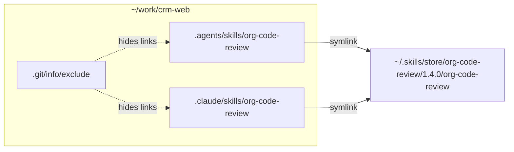
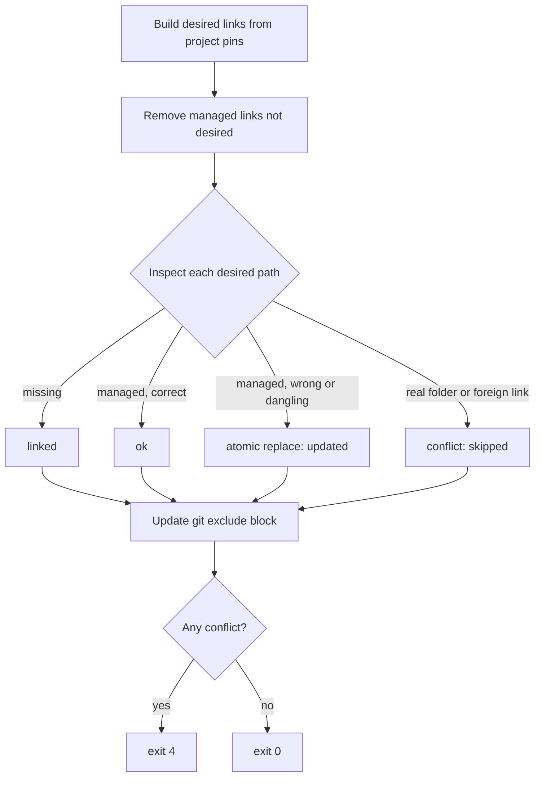

# Linking

## Result in a project



Links are absolute and point straight at the store, never at each other.

| Link target | Read by | Default |
|---|---|---|
| `.agents/skills/` | Cursor, ZohoCode | On |
| `.claude/skills/` | Claude Code, Cursor | On |
| `.zcode/skills/` | ZohoCode | Off |
| `.cursor/skills/` | Cursor | Off |

Targets are a setting; change with `config set link_targets` then `relink --all`.

## Ownership rule

A path is managed by `skillctl` **only if it is a symlink pointing into the store**. Everything else is never touched. No extra bookkeeping is needed, even if the registry is lost.

## Reconcile

`reconcile()` is the only code path that creates or deletes links.



Atomic replace: create `.<name>.skillctl-tmp`, then rename over the old link.

## Instance resolution

Paths are unreliable (case-insensitive APFS, `/tmp` → `/private/tmp`), so folders are matched by **device + inode**: walk from the current folder up to `/`; the first ancestor matching an instance wins.

## Git exclude block

Per-instance managed block in `info/exclude` (never pushed), listing each link individually so project-owned skills stay visible to Git.

```
# >>> skillctl /Users/me/work/crm-web >>>
/.agents/skills/org-code-review
/.claude/skills/org-code-review
# <<< skillctl /Users/me/work/crm-web <<<
```

## Global skills

Pinned in the registry's `global` section and linked into `~/.claude/skills/`. A name cannot be both global and project-pinned. No Git exclude step applies.
