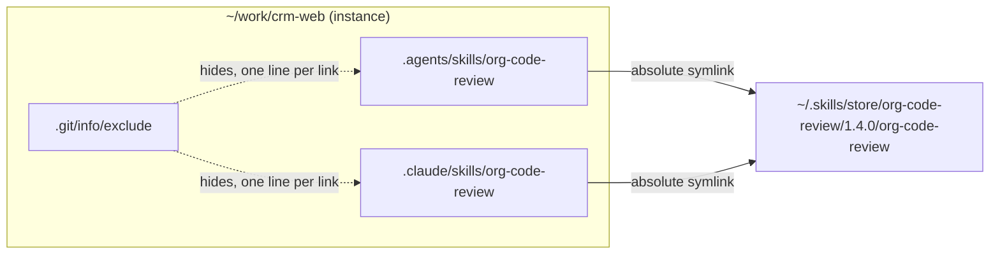
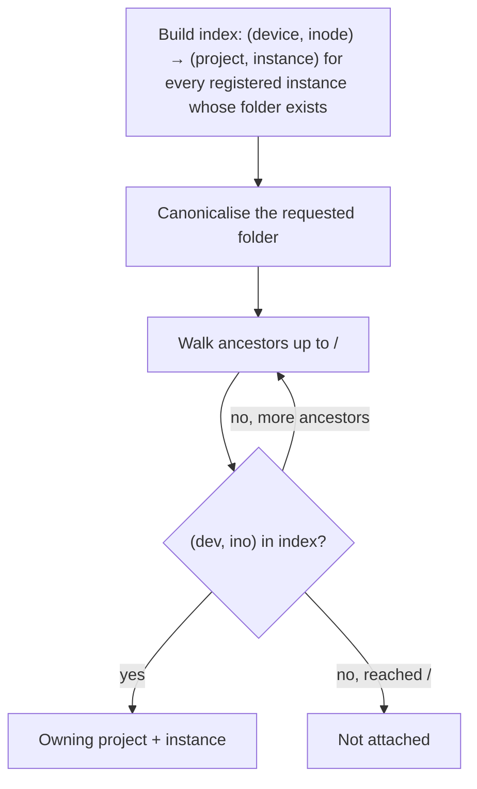
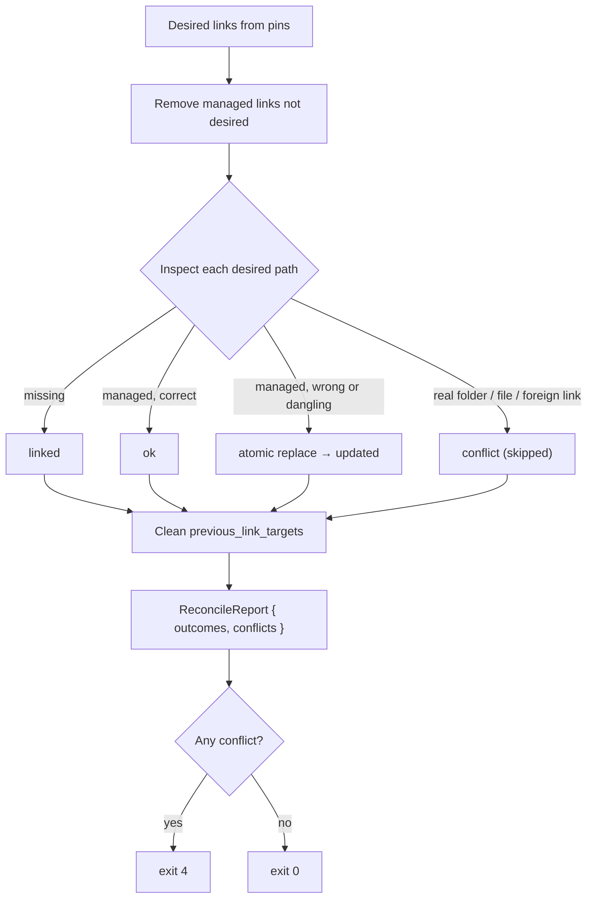
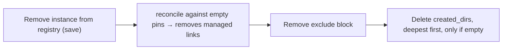

# Linking

Linking is where correctness matters most: skillctl must create and delete symlinks inside other people's repositories without ever touching a file it did not create. Four pieces carry that guarantee: the ownership rule, instance resolution by file identity, the reconcile algorithm, and the Git exclude block.

## Result in an instance



Links are absolute and point straight at the store (or at a draft folder), never at each other, so no harness has to follow a chain.

| Link target | Read by | Default |
|---|---|---|
| `.agents/skills/` | Cursor, ZohoCode | on |
| `.claude/skills/` | Claude Code, Cursor (compatibility scan) | on |
| `.zcode/skills/` | ZohoCode | off |
| `.cursor/skills/` | Cursor | off |

The list is `settings.link_targets` in the registry, so switching layouts is a config change followed by `relink --all`.

## Ownership rule

> A path inside a link target is managed by skillctl **if and only if** it is a symlink whose destination lies inside the store or the drafts folder. Everything else — real folders, regular files, links elsewhere — belongs to the project and is never modified or deleted.

The check normalises the link's destination lexically without following it, so a dangling managed link (its version was deleted) is still recognised and repaired, and a destination like `store/../../outside` cannot claim ownership. The rule needs no extra bookkeeping and stays correct even if the registry is lost.

## Instance resolution

Textual path comparison is unreliable on macOS: APFS is case-insensitive by default, and `/tmp` and `/var` are symlinks into `/private`. `registry::resolve::InstanceResolver` therefore compares file identity.



- The index is built once per command while the caller holds the registry lock. Missing instance folders are skipped (a `doctor` concern); other filesystem errors propagate.
- Because instances never nest, at most one ancestor can match, and the first match wins.
- `attach` stores `canonicalize(cwd)`, so registered paths already have symlinks resolved.
- Resolution performs no writes and works unchanged in dry runs.

## Reconcile

`linker::reconcile(fs, paths, instance, pins, settings, layout)` is the **only** code path that creates or deletes links. Every command that changes links calls it, and `--dry-run` runs the identical function over `DryRunFs` with a cloned instance.

### Link plans by kind

Before anything is touched, `linker::plans` turns the pins into `LinkPlan { dir, name, target }` records. With `Layout::Kinds` (project instances) the artifact's kind, read from its store folder, decides the plan; with `Layout::Folders` (user-level folders such as `~/.claude/skills` and `~/.claude/hooks`) every pin is a folder link into every target, whatever its kind.

| Kind | Plans |
|---|---|
| skill | `<target>/<name>` → `store/<name>/<ver>/<name>` for every `settings.link_targets` entry (duplicates collapsed) |
| rule | `.cursor/rules/<name>.mdc` → `…/<name>/RULE.mdc` |
| command | `.claude/commands/<name>.md` and `.cursor/commands/<name>.md` → `…/<name>/COMMAND.md` |
| agent | `.claude/agents/<name>.md` → `…/<name>/AGENT.md`; plus `.cursor/agents/<name>.md` → `…/<name>/cursor.md` when that override file exists |
| script | `.claude/scripts/<name>` → `store/<name>/<ver>/<name>` (a folder link, so `AGENTS.md` can name `.claude/scripts/<name>/<wrapper>` across versions) |
| hook | none here; `hook add` links it under `~/.claude/hooks` with `Layout::Folders` |

A pin whose store folder is missing is planned as a skill so its dangling links still show up for `doctor`. The folders visited are every `link_targets` entry, every folder a plan names, and (in `Kinds` layout) the kind folders (`.cursor/rules`, `.claude/commands`, `.cursor/commands`, `.claude/agents`, `.cursor/agents`, `.claude/scripts`) even when nothing is planned for them, so the links of an unpinned rule or command are removed. `status`, `doctor` and `global list` compute link health from the same plans, so what is reported is exactly what reconcile maintains.

```
plans = linker::plans(pins, settings.link_targets, layout)
for dir in link_targets ∪ {plan.dir} ∪ kind folders:
    dir = instance.path / target
    here = plans with plan.dir == dir
    for entry in list(dir) if dir exists:
        if entry is a managed link and entry.name not in {plan.name for plan in here}:
            delete link                                         -> removed
    for plan in here:
        p = dir / plan.name; want = plan.target
        match inspect(p):
            missing                 -> ensure_dir(dir); symlink(want, p)   -> linked
            managed link == want    -> nothing                             -> ok
            managed link != want    -> atomic replace with want            -> updated
            anything else           -> leave untouched                     -> conflict
for target in settings.previous_link_targets not in link_targets:
    remove managed links there (never directories, never project entries)
return per-link outcomes
```



Details that matter:

- **`ensure_dir`** creates missing folders one component at a time and appends each one it creates to `instance.created_dirs`. Pre-existing folders are never recorded, so `detach` can only remove what skillctl made. A symlink or non-directory anywhere in the link-target chain is a conflict, not something to traverse.
- **Atomic replace** creates the new link under an exclusively named temporary name (`.skillctl-<pid>-<counter>.tmp`) in the same folder and renames it over the old link, so a harness never observes the skill missing. A failed rename preserves the old link and cleans the temporary one. Existing temporary paths are never overwritten.
- **Dangling managed links** count as "managed link != want" and are replaced.
- **`previous_link_targets`** is kept in the registry until the next successful, conflict-free `relink --all`, so a target dropped from the settings still gets its managed links cleaned.
- **Conflicts never abort the run.** They are collected into the report, printed, and mapped to exit code 4 by the command. Other skills and other targets still converge.
- Callers own locking and persistence: they save intended pins **before** calling `reconcile` and save `created_dirs` **after**, including after partial failure.

## Git exclude block

When `settings.git_exclude` is true and the instance is inside a Git work tree, `linker::exclude` hides the links in the per-repository exclude file, which Git never pushes.

1. `Git::toplevel` runs `git -C <instance> rev-parse --show-toplevel`; `Git::exclude_file` runs `rev-parse --path-format=absolute --git-path info/exclude`, which returns the right file for linked worktrees, where `.git` is a file rather than a folder. Outside a work tree both return `None` and the step is skipped silently.
2. Each link path is made relative to the top level and anchored with a leading `/`, with gitignore metacharacters kept literal.
3. Only the block between markers keyed by the **instance path** is rewritten, so linked worktrees that share one exclude file do not overwrite each other, and the developer's own lines are untouched.

```
# >>> skillctl /Users/me/work/crm-web >>>
/.agents/skills/org-code-review
/.claude/skills/org-code-review
# <<< skillctl /Users/me/work/crm-web <<<
```

Links are listed individually, never as a folder pattern, so a project's own committed skills in the same folder stay visible to Git. Folders that skillctl created and that contain only excluded links stay invisible because Git does not track empty folders. The file is written with `Fs::write_atomic`; a dry run records the planned write and leaves the bytes unchanged. `detach` removes the block (unless `--keep-links`), and only links that were successfully managed are listed.

## Detach cleanup



Real project content, foreign links and symlinked directory chains are preserved throughout. `--keep-links` skips every filesystem step; `--delete-project` removes the project entry only when its last instance leaves.

## Global skills, commands and agents

Global skills are pinned once in the registry's `global.skills` map and linked into **user-level** folders instead of project folders, so every folder a harness opens sees them.

| User-level folder | Read by | Default |
|---|---|---|
| `~/.claude/skills/` | Claude Code, Cursor | on |
| `~/.agents/skills/` | Cursor | off (Cursor also reads `~/.claude/skills/`, so both would list each skill twice) |
| `~/.cursor/skills/` | Cursor | off |
| ZohoCode user-level folder | ZohoCode | unknown; add to `global_link_targets` once confirmed |

- The same `reconcile` engine runs with the home folder as the instance and `settings.global_link_targets` (with `~` expanded) as the targets. Links are created **per skill** inside the resolved folder; if `~/.claude/skills/` is itself a symlink it is resolved first, and a whole-folder link is never created.
- The ownership rule applies unchanged: the developer's own personal skills in those folders are never modified, and a real folder with a global skill's name is reported as a conflict.
- **No name clash with project skills**, in either direction. `global add` refuses a name any project pins and `add` refuses a global name, because Claude Code ranks personal skills above project skills and a clash would make the global one win silently.
- **No Git exclude step**, since home folders are not project repositories.
- `settings.global_in_instances: true` additionally links global skills into every attached instance's link targets (a stopgap to reach harnesses without a known user-level folder). Global mutations then reconcile every instance as well.
- `relink --all` reconciles globals first, then every instance.
- **Commands and agents can be global too.** `global::split` separates the global pins by detected kind: skills keep the `Folders` layout into `global_link_targets`; commands and agents are reconciled with the `Kinds` layout and the user home as the instance root (`global::reconcile_user_level`), so they land exactly where a project would put them, one level up: `~/.claude/commands/<name>.md`, `~/.cursor/commands/<name>.md`, `~/.claude/agents/<name>.md` and `~/.cursor/agents/<name>.md` for a `cursor.md` override. That reconcile always runs, even with no such pins, so a removed global's links are swept; under the ownership rule only symlinks into the store or drafts are touched, so the user's own command and agent files stay. Rules (`~/.cursor/rules` is not read by Cursor) and scripts (paths are project-relative) are refused, hooks go through `hook add`. `doctor` checks these links with the same plans (`global::user_level_plans`), and `doctor --fix` repairs them through `pins::reconcile_everything`.
