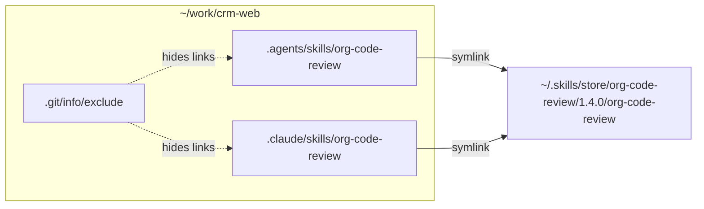
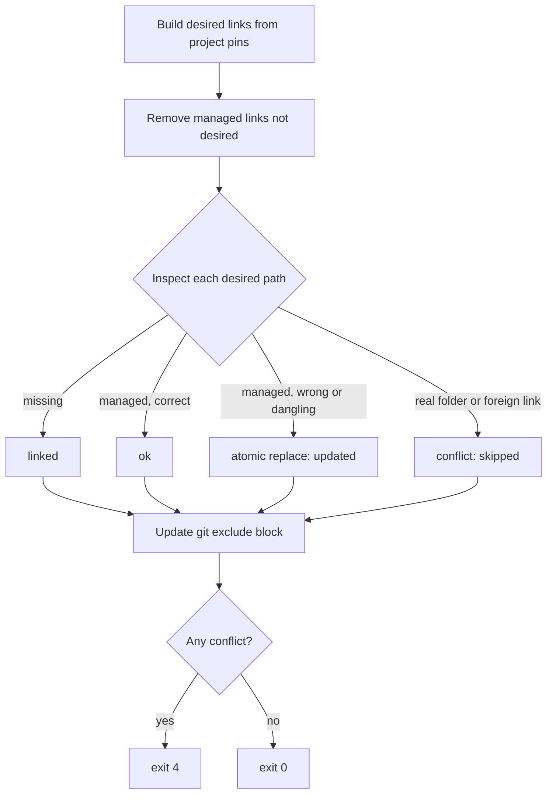

# Linking

## Result in a project



Links are absolute and point straight at the store, never at each other.

| Link target | Read by | Default |
|---|---|---|
| `.agents/skills/` | Cursor, ZohoCode | On |
| `.claude/skills/` | Claude Code, Cursor | On |
| `.zcode/skills/` | ZohoCode | Off |
| `.cursor/skills/` | Cursor | Off |

Targets are a setting; change with `config set link_targets` then `relink --all`.

## Ownership rule

A path is managed by `skillctl` **only if it is a symlink pointing into the store or drafts**. Everything else is never touched. No extra bookkeeping is needed, even if the registry is lost.

## Reconcile

`reconcile()` is the only code path that creates or deletes links.



`linker::reconcile` takes the filesystem service, home paths, mutable instance, project pins, and settings. It returns serializable per-link outcomes (`linked`, `ok`, `updated`, `removed`, `conflict`). Callers hold the exclusive registry lock, persist intended pins before reconciling, persist newly recorded `instance.created_dirs` afterward (including after partial failure), and map collected conflicts to exit code 4. Dry runs use the same algorithm with `DryRunFs` and a cloned instance; shared missing parent directories are planned only once.

Atomic replace creates an exclusively named `.skillctl-<pid>-<counter>.tmp` symlink beside the old link, then renames it over the old link. A failed rename preserves the old link and attempts temporary-link cleanup. Existing temporary paths are never overwritten.

Missing target folders are created one component at a time and recorded for later detach cleanup; pre-existing folders are not recorded. Symlinks and non-directories in the link-target directory chain are skipped as conflicts rather than traversed. Ownership checks normalize relative link destinations without following them, so dangling managed links remain repairable and `store/../../outside` cannot claim ownership. Obsolete `previous_link_targets` are cleaned without touching project-owned entries or deleting directories; only a successful future `relink --all` clears that settings history.

Git exclude editing is provided by `linker::exclude` (item 22); attach/status command integration follows in item 23.

## Instance resolution

Paths are unreliable (case-insensitive APFS, `/tmp` → `/private/tmp`), so folders are matched by **device + inode**: walk from the current folder up to `/`; the first ancestor matching an instance wins.

## Git exclude block

Per-instance managed block in `info/exclude` (never pushed), listing each link individually so project-owned skills stay visible to Git.

```
# >>> skillctl /Users/me/work/crm-web >>>
/.agents/skills/org-code-review
/.claude/skills/org-code-review
# <<< skillctl /Users/me/work/crm-web <<<
```

## Global skills

Pinned in the registry's `global` section and linked into `~/.claude/skills/`. A name cannot be both global and project-pinned. No Git exclude step applies.
