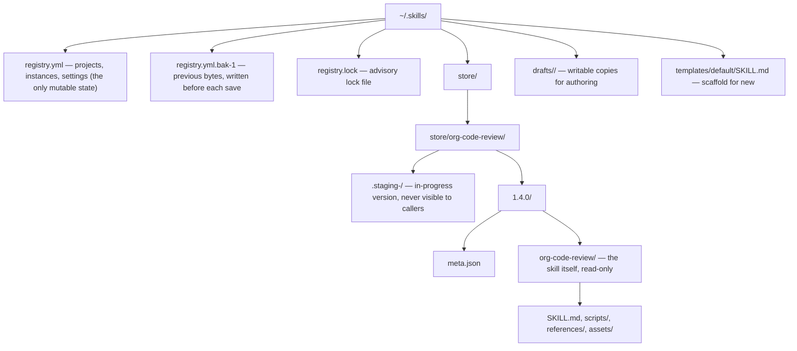
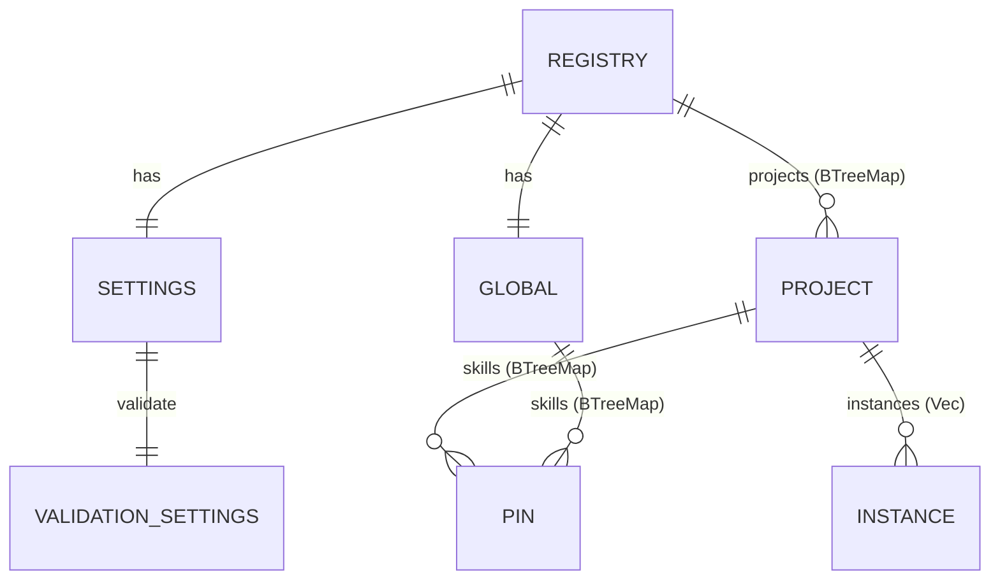
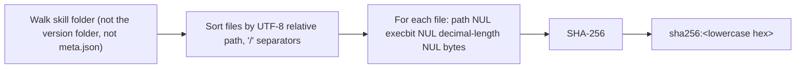
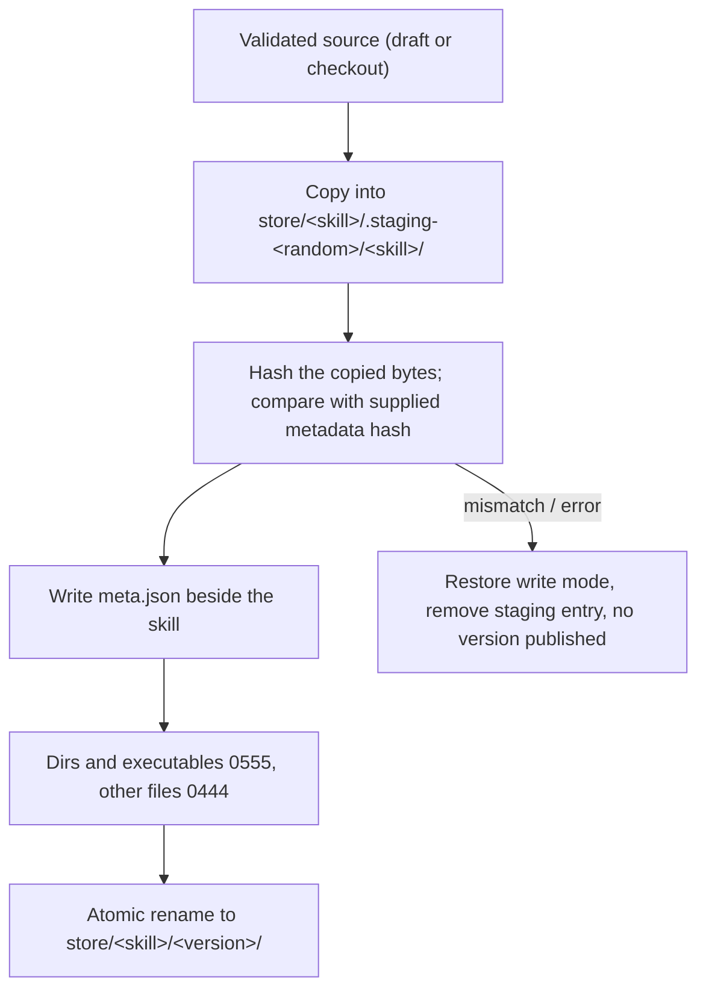

# Storage and Registry

All state lives under one home folder: `~/.skills/` by default, overridable with `--home` or `SKILLCTL_HOME`. Project folders only ever receive symlinks.

## Home folder layout



The skill folder sits **one level below** its version folder so that its own folder name is exactly the skill `name`; the spec and Cursor require that `name` match the folder name even when a link is resolved to its real path. `meta.json` sits beside the skill rather than inside it, so harnesses never see it and the validator never flags it as an unreferenced file.

## Registry data model



```yaml
schema: 1
settings:
  link_targets: [".agents/skills", ".claude/skills"]   # RelPath, linked inside every instance
  git_exclude: true
  global_link_targets: ["~/.claude/skills"]             # HomePath, expanded at use
  global_in_instances: false
  validate:
    allow: []                                           # org/harness rule IDs suppressed globally
  previous_link_targets: []                             # omitted when empty; see Linking
global:
  skills:
    org-commit-message: 2.0.1
projects:
  crm-web:
    skills:
      org-code-review: 1.4.0
      payments-deploy: draft
    instances:
      - path: /Users/me/work/crm-web
        attached_at: 2026-10-18T09:12:00Z
        created_dirs: [".agents", ".agents/skills"]
```

| Type | Fields | Notes |
|---|---|---|
| `Registry` | `schema: u32`, `settings`, `global`, `projects: BTreeMap<ProjectName, Project>` | `BTreeMap` keeps YAML sorted so diffs stay readable if the home folder is kept in a personal Git repo. Unknown fields are rejected (`deny_unknown_fields`). |
| `Settings` | `link_targets: Vec<RelPath>`, `git_exclude: bool`, `global_link_targets: Vec<HomePath>`, `global_in_instances: bool`, `validate: ValidationSettings`, `previous_link_targets: Vec<RelPath>` | Defaults apply field by field, so a registry written by an older build loads with new settings defaulted. |
| `Project` | `skills: BTreeMap<SkillName, Pin>`, `instances: Vec<Instance>` | |
| `Instance` | `path: PathBuf`, `attached_at: DateTime<Utc>`, `created_dirs: Vec<RelPath>` | `path` is absolute and canonical. `created_dirs` lists folders skillctl created, shallowest first, so `detach` removes only those and only when empty. |
| `Pin` | `Version(semver::Version)` or `Draft` | Serialised as `"1.4.0"` or `"draft"`. |

### Invariants enforced on load

- `schema` is checked **before** any other field is interpreted; an unsupported value aborts with a message to upgrade skillctl rather than a parse error on a newer layout.
- Project and skill names follow the spec pattern, enforced by the newtypes' `Deserialize`.
- Instance paths are absolute, each path appears in at most one project, and no instance path is an ancestor of another, so any folder resolves to exactly one project.
- Duplicate skill keys in one map are rejected rather than silently last-wins.
- Pinned versions are **not** required to exist in the store at load time; a missing version is a `doctor` finding, so a damaged store never locks the user out of the registry.

### Save path

`Registry::save` serialises to YAML, copies the previous bytes to `registry.yml.bak-<schema>`, then performs an atomic write through the `Fs` service. A failed serialisation or backup never replaces the destination.

## Store queries

The directory tree **is** the index; queries do not open `meta.json` or `SKILL.md`, so a damaged version stays visible for diagnosis.

| Function | Behaviour |
|---|---|
| `list_skills` | Valid skill-name directories under `store/`, sorted. Files, symlink entries, staging directories and invalid names are ignored; a missing store yields an empty list. |
| `list_versions` | Semver directories under `store/<skill>/`, ascending, including prereleases and build metadata. |
| `latest_stable` | Highest version with no prerelease component. Never falls back to a prerelease: 1.5.0 wins over 1.4.0 and over 1.6.0-beta. |
| `store_dir(name, pin)` | `store/<name>/<version>/<name>` or `drafts/<name>`, computed without touching disk so dangling links can still be reasoned about. |
| `resolve_pin` | Accepts an explicit version, `draft`, or nothing (latest stable), and checks that the target and its managed ancestors are real directories. A missing explicit pin is an error, never a request to pick a different version. |

Queries perform no writes, including in dry runs. Callers hold the registry lock for a consistent view.

## `meta.json`

```json
{
  "name": "org-code-review",
  "version": "1.4.0",
  "source": { "kind": "git", "url": "git@gitlab.example.com:platform/org-skills.git", "ref": "v1.4.0", "commit": "9f2c1e7", "subdir": "skills/org-code-review" },
  "content_hash": "sha256:4b1f…",
  "installed_at": "2026-10-18T09:05:00Z",
  "skillctl_version": "0.1.0"
}
```

`source.kind` is `git`, `local` (installed from a path or sealed from a draft) or `new`. Git sources carry `url` and `commit`, with optional `ref` and repository-relative `subdir`. `Metadata` is read and atomically written through the `Fs` service; missing or malformed metadata is an error, not a default. Because `meta.json` lives beside the skill folder, writing it never changes the content hash.

## Canonical content hash



- Any Unix execute bit marks a file executable (`1`); other permission bits, timestamps, the absolute root location and empty directories do not affect the hash. Making a version read-only therefore preserves its identity.
- Symlinks (including the root), special files and non-UTF-8 paths are rejected, so the stream never has to describe them.
- Hashing reads through the `Fs` service and performs no writes.

## Staging and the read-only store



- An existing version directory (even empty, even a symlink) is never replaced.
- Symlinks and special files in the source are rejected; source permissions are never modified; empty directories are retained.
- `restore_write_mode` resets a version to `0755` throughout so a later `gc` can delete it; it refuses symlinks and deletes nothing itself.
- All of this runs through `Fs`, so `seal --dry-run` hashes the planned copy and records creation, writes, mode changes and the final rename without creating a staged folder.

## Drafts

`~/.skills/drafts/<skill>/` is an ordinary writable folder. `new` scaffolds it from `templates/<name>/SKILL.md`, replacing `{{name}}` and setting `metadata.version: 0.1.0`, and creates empty `scripts/` and `references/`. `seal` runs the full validator, stages the draft into the store with `source.kind: local` (applying `--bump` to the stored copy's frontmatter), and removes the draft only after the version is published. A draft can be pinned with `add <skill> --draft`, in which case links point at the draft folder and `status` shows the pin as `draft`.

## Locking and atomic writes

| Mechanism | Detail |
|---|---|
| Advisory lock | `RegistryLock` on `registry.lock` via `fd-lock`. Exclusive for writers, shared for readers. A second process waits up to 10 seconds, then fails with a clear message. |
| Atomic write | `Fs::write_atomic`: temporary file in the same directory, `fsync`, rename over the original. Used for the registry, `meta.json` and the Git exclude file. |
| Order of operations | Registry first, filesystem second. A crash between the two leaves a registry that describes the intended state; `relink` converges the filesystem. |
| Staged installs | New versions are built under `.staging-*` and renamed into place only after validation and hashing, so a failed install or seal never leaves a half-written version. |
| Read-only store | Prevents accidental edits through a project link, including edits by an AI agent. Write mode is restored only immediately before deletion. |
