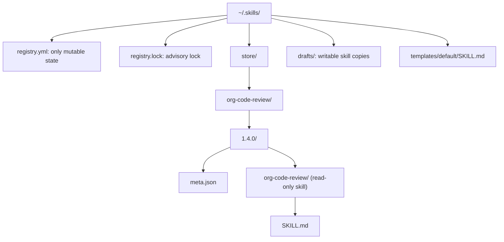
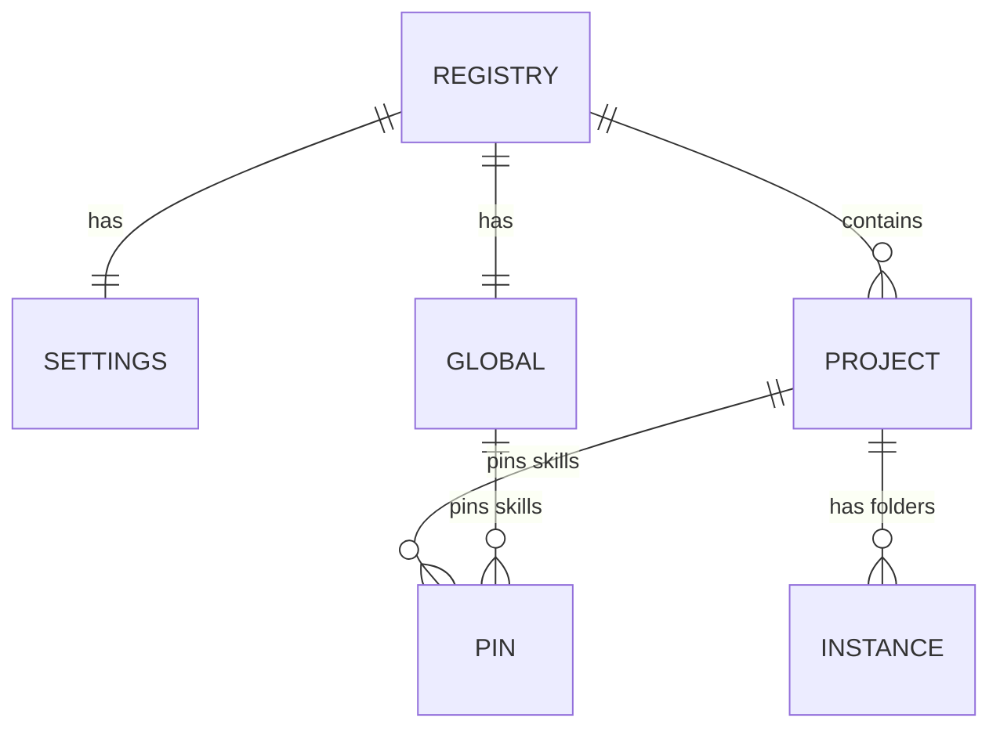
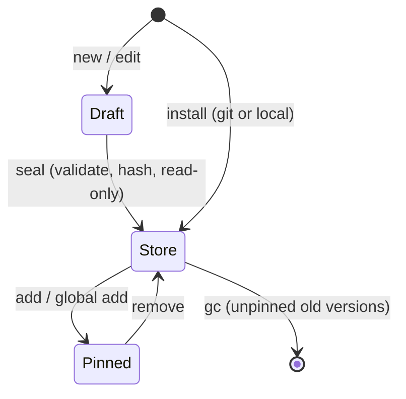

# Storage and Registry

All state lives under `~/.skills/` (override with `SKILLCTL_HOME` or `--home`). Projects only ever receive symlinks.

## Home layout

The skill folder sits **below** the version folder, so its name equals the skill `name` that harnesses require. `meta.json` sits beside it so harnesses never see it.

## Registry model

- **Pin**: a semver version or `draft`
- **Instance**: one folder on disk (clone, copy, worktree)
- Instance paths are canonical, unique, and never nested
- `BTreeMap` keeps YAML sorted for clean diffs

## Skill lifecycle

## Safe writes

- **Lock**: exclusive for writers, shared for readers, 10 s wait
- **Atomic**: temp file, `fsync`, rename
- **Order**: write registry first, then reconcile; `relink` repairs partial runs
- **Staged installs**: built in `.staging-*`, renamed only after validation and hashing
- **Read-only store**: dirs `0555`, files `0444`, executables `0555`
- **Content hash**: SHA-256 over sorted files (path, exec bit, length, bytes); `doctor` detects tampering

### Canonical content hash

`store::hash::content_hash` hashes the skill folder itself, excluding the enclosing
version folder and its `meta.json`. It returns `sha256:<lowercase hex>`.
Files are sorted globally by UTF-8 relative path using `/` separators. Each file
contributes its path, a NUL byte, `0` or `1` for the executable flag, a NUL byte,
the decimal byte length, a NUL byte, then its exact bytes.

Any Unix execute bit marks a file executable. Other permission bits, timestamps,
the absolute root location and empty directories do not affect the hash, so
making a version read-only preserves its identity. Symlinks (including the root),
special files and non-UTF-8 file paths are rejected. Hashing uses the filesystem
service and performs no writes, including in dry-run mode. The caller must keep
the tree unchanged while hashing.
