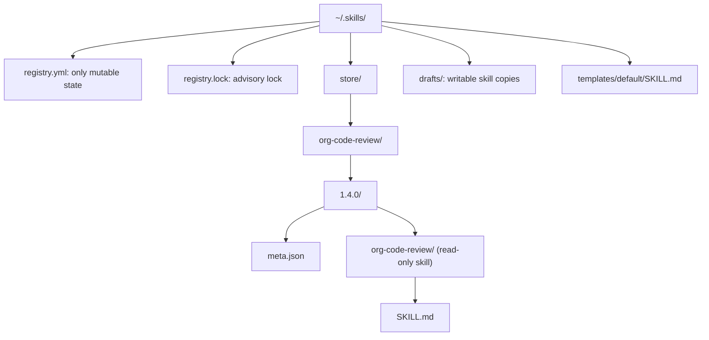
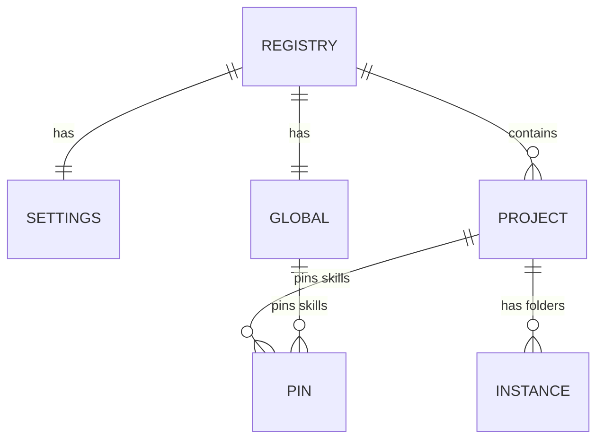
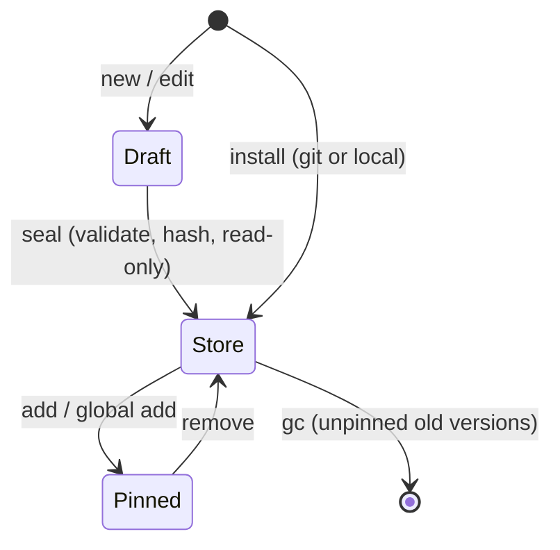

# Storage and Registry

All state lives under `~/.skills/` (override with `SKILLCTL_HOME` or `--home`). Projects only ever receive symlinks.

## Home layout

The skill folder sits **below** the version folder, so its name equals the skill `name` that harnesses require. `meta.json` sits beside it so harnesses never see it.

## Store metadata

`store::meta::Metadata` reads and atomically writes a full `meta.json` path through
the filesystem service. It records the validated skill name, semver version,
source (`git`, `local`, or `new`), content hash, UTC installation timestamp, and
semver `skillctl_version`. Git sources include a URL and resolved commit, with
optional `ref` and repository-relative `subdir`.

The caller supplies the timestamp and hash and holds the appropriate registry
lock. Metadata lives beside the skill directory, so writing it does not change
the content hash. Missing or malformed metadata is an error, not a default;
dry-run saves record the exact planned atomic write without modifying disk.
Staging and read-only permissions are handled by `store::stage`.

## Staging and permissions

`stage_version` copies an already validated source into
`store/<skill>/.staging-<random>/<skill>/`, hashes the exact copied bytes using the
canonical encoding, and verifies the supplied metadata hash. It writes `meta.json`
beside the skill, seals the entire version, then atomically renames it to
`store/<skill>/<version>/`. Existing versions (including empty directories and
symlinks) are never replaced. Callers must hold the exclusive registry lock and
keep the source unchanged during staging; validation is the caller's responsibility.

Directories and executable files become `0555`; other files, including metadata,
become `0444`. Source permissions are not changed, empty directories are retained,
and symlinks and special files are rejected. Failed stages restore permissions and
remove their staging entries without publishing a version. Cleanup failures report
the abandoned staging path. The source or draft is never deleted by staging.

All mutations use the filesystem service. Dry runs hash the planned copy and record
creation, writes, permission changes and publication without creating staged files.
`restore_write_mode` restores `0755` throughout a version for later garbage
collection; it refuses symlinks before changing permissions and does not delete
anything itself.

## Registry model

- **Pin**: a semver version or `draft`
- **Instance**: one folder on disk (clone, copy, worktree)
- Instance paths are canonical, unique, and never nested
- `BTreeMap` keeps YAML sorted for clean diffs

## Skill lifecycle

## Safe writes

- **Lock**: exclusive for writers, shared for readers, 10 s wait
- **Atomic**: temp file, `fsync`, rename
- **Order**: write registry first, then reconcile; `relink` repairs partial runs
- **Staged installs**: built in `.staging-*`, renamed only after validation and hashing
- **Read-only store**: dirs `0555`, files `0444`, executables `0555`
- **Content hash**: SHA-256 over sorted files (path, exec bit, length, bytes); `doctor` detects tampering

### Canonical content hash

`store::hash::content_hash` hashes the skill folder itself, excluding the enclosing
version folder and its `meta.json`. It returns `sha256:<lowercase hex>`.
Files are sorted globally by UTF-8 relative path using `/` separators. Each file
contributes its path, a NUL byte, `0` or `1` for the executable flag, a NUL byte,
the decimal byte length, a NUL byte, then its exact bytes.

Any Unix execute bit marks a file executable. Other permission bits, timestamps,
the absolute root location and empty directories do not affect the hash, so
making a version read-only preserves its identity. Symlinks (including the root),
special files and non-UTF-8 file paths are rejected. Hashing uses the filesystem
service and performs no writes, including in dry-run mode. The caller must keep
the tree unchanged while hashing.
