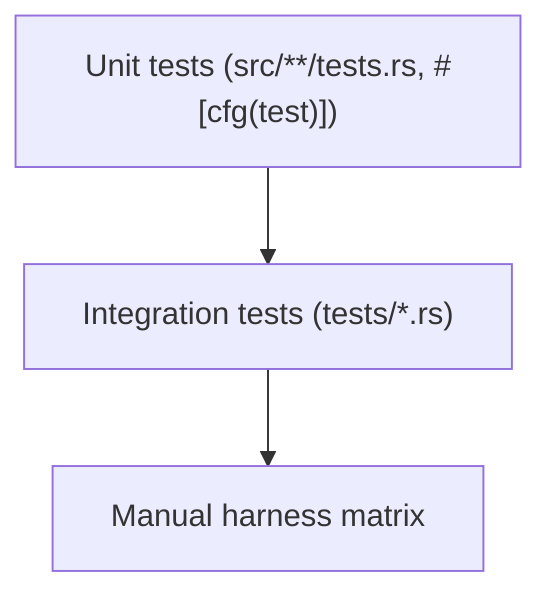
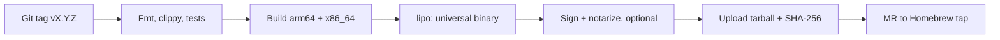

# Testing and Release

## Testing



- **Unit**: names, paths, registry round-trip, hash, frontmatter, exclude block, one fixture per rule
- **Integration**: drive the binary with `assert_cmd`; every test sets `SKILLCTL_HOME` to a temp dir
- **Manual**: confirm Claude Code, Cursor and ZohoCode list and run linked skills; failures are fixed by changing `link_targets`, not code

CI runs `cargo fmt --check`, `cargo clippy -- -D warnings` and `cargo test --locked`.

## Milestone-2 acceptance coverage (item 27)

`cli_workflow` exercises init/new/seal, two Git instances, project-wide additions, `git clean -fdx` recovery, and detach without changing committed project content. Recursive snapshots compare file bytes, permissions, directory presence and symlink destinations around dry-run attachment, pin changes, relinking, detach, global changes and scaffolding. Dedicated command tests also cover sealing dry runs, non-terminal missing answers, concurrent additions and personal-skill conflicts. All test homes and global targets are temporary.

CI runs the locked suite, formatting and Clippy on Linux and macOS 14 (Apple silicon). Local Linux success does not certify the remote macOS job or real harness behavior.

## Full validation coverage (item 29)

`full_validation` creates isolated fixtures for every O/H rule (H204 suppresses the unavoidable accompanying H201 field warning), plus valid bundled resources, character budgets, percent-encoded paths, symlink cycles, secret redaction, suppression/strict policy and read-only filesystem inspection. `cli_validate` exercises arbitrary paths, explicit versions, drafts, all-target reports, single-document failures, JUnit parsing/escaping and multiple error elements, registry allow-lists during sealing, no-write dry runs, quiet/format precedence and optional reference-tool behavior. Registry round trips include the new nested validation setting. These tests use temporary homes and never invoke scripts bundled in skills. Real GitLab JUnit ingestion remains unverified locally.

Item 28 is explicitly deferred at the developer's request; implementation proceeds with item 29 without claiming harness compatibility results.

Local item-29 verification: the complete serial suite passes (211 tests, three intentionally ignored subprocess helpers), as do all new validation tests with normal parallel execution, formatting and all-target Clippy. Normal full-suite runs can still intermittently fail in the pre-existing Git-service fake-executable test with OS error 26 (`Text file busy`); this is not treated as a validation success or fixed by this work item. macOS CI and live GitLab JUnit widgets remain externally unverified.

## Manual compatibility gate (item 28)

Not executable in the current Linux workspace. No harness versions or results have been inferred. Record a version and result for each cell before declaring this item complete:

| Check | Claude Code (version pending) | Cursor (version pending) | ZohoCode (version pending) |
|---|---|---|---|
| Skill listed and triggers appropriately | Not run | Not run | Not run |
| Listed once with both default link targets | N/A | Not run | Not run |
| Script runs from read-only store path | Not run | Not run | Not run |
| Sandbox allows reading external skill store | Not run | Not run | Not run |
| Draft link discovered | Not run | Not run | Not run |
| Linked Git worktree discovered | Not run | Not run | Not run |
| User-level skill discovery and precedence | Not run | Not run | Not run |

Keep defaults provisional until this matrix establishes symlink support and duplicate handling. Release signing, notarization, Homebrew publishing and clean-Mac installation likewise require their real environments and credentials.

## Release



Release profile: `lto = "thin"`, `codegen-units = 1`, `strip = true`.

## Install

```
brew tap zoho/tools git@gitlab.zoho.com:platform/homebrew-tools.git
brew install skillctl
skillctl init
```

## Roadmap

| Milestone | Scope |
|---|---|
| M1 | Store, registry, `init`, `new`, `seal` |
| M2 | `attach`, `detach`, `status`, `add`, `remove`, `relink`, reconcile |
| M3 | Manual harness matrix |
| M4 | Full validation, `install`, `edit` |
| M5 | `doctor`, `gc`, `config`, release |

## Key risks

| Risk | Mitigation |
|---|---|
| Harness stops following symlinks | Re-run matrix; future copy mode |
| Cursor lists skills twice | Switch to fallback `link_targets` |
| Registry lost | Backups; managed links stay recognisable |
| `git clean -fdx` removes links | `relink` |
