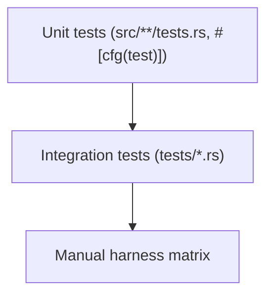
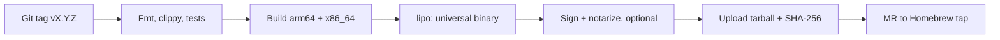

# Testing and Release

## Testing



- **Unit**: names, paths, registry round-trip, hash, frontmatter, exclude block, one fixture per rule
- **Integration**: drive the binary with `assert_cmd`; every test sets `SKILLCTL_HOME` to a temp dir
- **Manual**: confirm Claude Code, Cursor and ZohoCode list and run linked skills; failures are fixed by changing `link_targets`, not code

CI runs `cargo fmt --check`, `cargo clippy -- -D warnings` and `cargo test --locked`.

## Release



Release profile: `lto = "thin"`, `codegen-units = 1`, `strip = true`.

## Install

```
brew tap zoho/tools git@gitlab.zoho.com:platform/homebrew-tools.git
brew install skillctl
skillctl init
```

## Roadmap

| Milestone | Scope |
|---|---|
| M1 | Store, registry, `init`, `new`, `seal` |
| M2 | `attach`, `detach`, `status`, `add`, `remove`, `relink`, reconcile |
| M3 | Manual harness matrix |
| M4 | Full validation, `install`, `edit` |
| M5 | `doctor`, `gc`, `config`, release |

## Key risks

| Risk | Mitigation |
|---|---|
| Harness stops following symlinks | Re-run matrix; future copy mode |
| Cursor lists skills twice | Switch to fallback `link_targets` |
| Registry lost | Backups; managed links stay recognisable |
| `git clean -fdx` removes links | `relink` |
