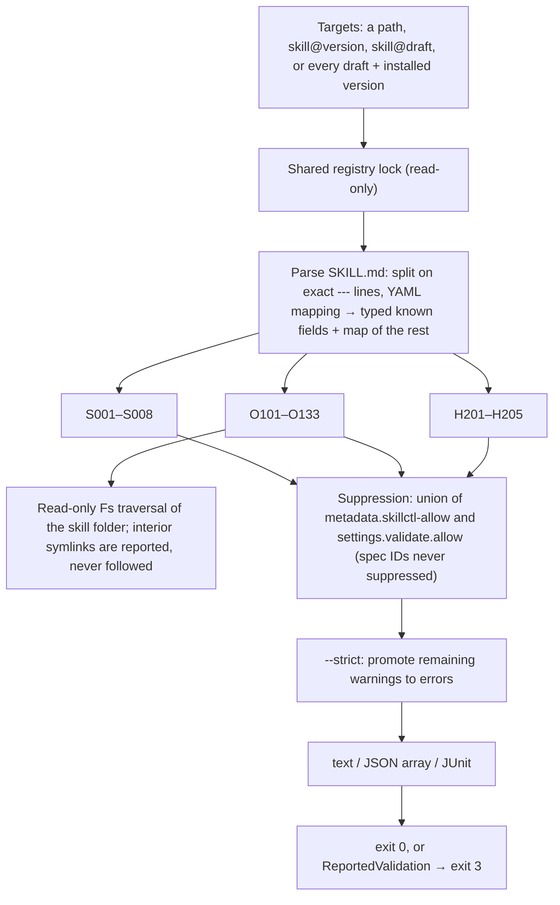

# Validation

The validator is native Rust. Rules are grouped into the Agent Skills **spec** (S), **organisation** quality rules (O) and **harness compatibility** (H). Each rule has a stable ID, a default severity and a short fix hint, so output can be filtered and CI can depend on IDs. Harnesses run skill scripts; skillctl only lints them and never executes anything bundled in a skill.

## Pipeline



- Structural prerequisites short-circuit: a missing `SKILL.md` or malformed frontmatter yields only its own finding (S001/S002) instead of a cascade.
- Field-level findings accumulate, so one run reports every problem.
- `validate::run` is the spec-only API used where only structural validity matters; `validate::run_all` composes all groups and applies suppression and strict policy. `seal` calls the same full runner with the registry allow-list before staging, so a sealed version can never contain unsuppressed errors.
- Filesystem failures propagate as `Error::Io`, separately from findings.

## Rule engine

```rust
pub enum Severity { Warning, Error }

pub struct Finding { rule: &'static str, severity: Severity, path: PathBuf, line: Option<usize>, message: String, hint: &'static str }

pub trait Rule {
    fn id(&self) -> &'static str;
    fn check(&self, skill: &ParsedSkill, findings: &mut Vec<Finding>);
    fn check_fs(&self, fs: &dyn Fs, skill: &ParsedSkill, findings: &mut Vec<Finding>) -> Result<(), Error> { Ok(()) }
}
```

`check` covers pure rules over the parsed document; `check_fs` is a default-empty extension for rules that must inspect bundled files through the injectable `Fs`, so adding filesystem-aware rules did not change existing implementations. Resource references are extracted with a CommonMark parser (`pulldown-cmark`); script and secret lints use precompiled regular expressions.

## Spec rules (always errors, never suppressible)

| ID | Check |
|---|---|
| S001 | `SKILL.md` exists at the skill folder root |
| S002 | Frontmatter is present and parses as a YAML mapping |
| S003 | `name` is present, 1–64 characters, matches `^[a-z0-9]+(-[a-z0-9]+)*$` |
| S004 | `name` equals the skill folder's name |
| S005 | `description` is present, non-empty, at most 1,024 characters |
| S006 | `compatibility`, if present, is 1–500 characters |
| S007 | `metadata`, if present, maps strings to strings |
| S008 | `license` and `allowed-tools`, if present, are strings |

## Organisation rules

| ID | Severity | Check |
|---|---|---|
| O101 | error | `metadata.version` is present and parses as semver |
| O102 | warning | `description` is at least 80 characters |
| O103 | warning | `description` contains a "when" clause describing the trigger (the word `when` or `whenever`) |
| O104 | error | `description` contains no `<` or `>` |
| O110 | warning | Body is at most 500 lines |
| O111 | warning | Body is at most 5,000 estimated tokens (Unicode characters ÷ 4) |
| O112 | warning | Each file in `references/` is at most 10,000 estimated tokens |
| O120 | error | Every relative path the body references (CommonMark links, images, reference links, and backtick paths starting with `scripts/`, `references/` or `assets/`) exists |
| O121 | warning | Every file under `scripts/`, `references/`, `assets/` is referenced at least once |
| O122 | error | No symlinks inside the skill folder |
| O123 | error | No reference escapes the skill folder (`..`, including percent-encoded traversal) |
| O130 | error | Each file in `scripts/` has a shebang line and the executable bit |
| O131 | warning | Scripts contain no interactive input (`read -p`, `read -r` from a terminal, Python `input()`) |
| O132 | error | Scripts contain no `curl … \| sh`, `wget … \| sh` or `sudo` |
| O133 | error | No likely secrets: private key headers, AWS-style access keys, tokens with common provider prefixes. Findings name the path and line but never echo the matched value. |

The O13x rules are static heuristics, not a sandbox or an exhaustive security audit.

## Directive-description rules (warnings)

`validate::description::DescriptionRules` runs on skills after the organisation rules. The description is the activation surface (only name and description are in context before a skill is chosen), and the rules encode the form that measured 100% activation without a hook. All are warnings so legacy skills still seal; `--strict` makes them errors in CI.

| ID | Rule |
|---|---|
| O140 | A trigger verb (`invoke`, `use`, `apply`, `run`, `load`, `activate`, `call`, optionally after `always`/`must`) addresses `this skill` within one sentence. The "when" clause is O103, so the two compose |
| O141 | A negative constraint is present: `do not`, `don't`, `never` or `must not` |
| O142 | Concrete trigger phrasings: at least two quoted phrases, or an `including` / `such as` / `for example` / `e.g.` / `phrasing like` clause |
| O143 | Not a per-skill rule: the index budget, computed by `commands::advisory::index` over the skills an agent sees (project pins plus global skills). Name plus description characters per skill, tokens as characters ÷ 4, total against `CONTEXT_WINDOW_TOKENS × INDEX_SHARE_PERCENT` (200,000 × 1%), and any description over `DESCRIPTION_MAX_CHARS` (1,536). Reported by `status --budget` and after `add`/`global add`/`attach --skills` |
| O144 | No hedging (`helps with`, `assists`, `can be used`, `useful for`, `various`, `general-purpose`, `and more`, `etc.`) and no scaffold `[placeholder]` left in |
| O145 | No `keywords` frontmatter field; it has no measured effect and its presence suggests the description relies on it |

`commands::advisory` also runs O140–O145 over the pinned skill after a pin changes and writes the findings and the budget line to stderr in text mode (never in `--json`, where the result object carries them under `advisory`). `hook add` runs the same rules over every pinned skill when the hook handles `UserPromptSubmit`.

## Harness compatibility rules (warnings)

Known-field lists live in `validate/fields.rs`, so updating them for a new harness release is a one-file change.

| ID | Check |
|---|---|
| H201 | Frontmatter fields that only Claude Code acts on (`context`, `agent`, `hooks`, `model`, `effort`, `shell`, `argument-hint`, `arguments`) are flagged with "other harnesses ignore this" |
| H202 | `allowed-tools` is set; support varies by harness and it pre-approves tools |
| H203 | The body uses Claude Code substitutions (`${CLAUDE_SKILL_DIR}`, `$ARGUMENTS`, `` !`command` `` injection), which other harnesses show as plain text |
| H204 | `context: fork` is combined with instructions to ask the user, which cannot work in a Claude Code subagent |
| H205 | Unknown frontmatter fields not in any harness's known list |

## Hook rules

A folder whose root document is `HOOK.md` is validated with these rules (K101–K111) instead of the S/O/H groups (`validate::hook::HookRules`). The runner's gate reports K101 where it would report S001/S002 for a skill. K101–K105 and K107 are structural: a hook failing them cannot be registered, so no allow-list suppresses them.

| ID | Severity | Rule |
|---|---|---|
| K101 | error | `HOOK.md` exists at the folder root, is UTF-8 and parses as YAML mapping frontmatter |
| K102 | error | `name` is present, matches `^[a-z0-9]+(-[a-z0-9]+)*$` and equals the folder name |
| K103 | error | `description` is present, non-empty, at most 1,024 characters |
| K104 | error | `metadata` maps strings to strings and `metadata.version` parses as semver |
| K105 | error | `events` is a non-empty YAML list of strings |
| K106 | warning | Every event name is in the known Claude Code list (`hook::KNOWN_EVENTS`); unknown names warn because the list grows with releases |
| K107 | error | `entry` is present, relative, has no `..`, and names a regular file inside the folder that starts with `#!` and has the executable bit |
| K108 | mixed | The entry script (and any other file starting with `#!`) requests no interactive input (warning) and contains no `sudo` or `curl … \| sh` (error); the heuristics are shared with O131/O132 |
| K109 | error | No likely secrets in any file (shared with O133; values are never echoed) |
| K110 | error | No symlinks inside the hook folder (`HOOK.md` itself included) |
| K111 | error | Registration fields are well-formed: `matchers`, if present, is a mapping from declared event names to string tool patterns; `timeout`, if present, is a whole number of seconds from 1 to 600 (`hook::MAX_TIMEOUT`) |

`events`, `entry`, `matchers` and `timeout` are read from the frontmatter's `extra` map rather than typed fields, so skill validation is unchanged: a skill carrying an `events:` key still gets H205.

## Instruction-file rules

`skillctl lint [<folder>]` runs `validate::instructions::check` on a project folder rather than on a store artifact. It reads `AGENTS.md`, `CLAUDE.md`, `.claude/CLAUDE.md` and `CLAUDE.local.md` into a `Layout` (and `.cursor/rules/*.mdc` for I302), decides whether any `CLAUDE.md` imports `AGENTS.md` (an `@AGENTS.md` or `@./AGENTS.md` token anywhere on a line for `./CLAUDE.md`, `@../AGENTS.md` for `.claude/CLAUDE.md`, since Claude Code resolves imports relative to the importing file; quoted paths do not count), and for I309 climbs the parents up to the Git top level (`Git::toplevel`) or the filesystem root. Nothing is written: these files are team-owned.

| ID | Severity | Rule |
|---|---|---|
| I301 | warning | `AGENTS.md` has at most 200 lines (`AGENTS_MAX_LINES`) |
| I302 | warning | Each `.cursor/rules/*.mdc` has at most 500 lines, and one whose frontmatter sets `alwaysApply: true` has at most 100 lines |
| I303 | warning | No `AGENTS.md` section (ATX headings split sections; headings inside fenced code do not) reads like a procedure: five or more ordered steps (`1.`/`1)` outside fenced code), three or more fenced code blocks, or a heading containing a procedure word (`how to`, `process`, `procedure`, `runbook`, `checklist`, `steps`, `workflow`, `release`, `deploy`, `deployment`, `migration`) together with at least three steps or one block. Reported at the heading line |
| I304 | error | Each existing `CLAUDE.md` imports `AGENTS.md`, and the imported `AGENTS.md` exists |
| I308 | warning | No comparable line (trimmed, ≥ 24 characters, not an import, containing a letter or digit) of `CLAUDE.md` also appears in `AGENTS.md`; reported per line |
| I309 | error | When `AGENTS.md` exists and nothing imports it, no `CLAUDE.md`, `.claude/CLAUDE.md` or `CLAUDE.local.md` exists in the folder or any parent up to the repository root, because any of them makes Claude Code skip `AGENTS.md`. A `CLAUDE.md` in the folder itself is reported as I304 instead |

I rules honour the registry allow-list (`settings.validate.allow`) and `--strict`. The remaining I3xx rules named by the optimisation strategy (I305 cacheable prefix, I306 quiet wrappers) are added with the work items that need them.

## Suppression and strict mode

- Per skill: `metadata.skillctl-allow: "O102,H201"` in the frontmatter.
- Everywhere: `settings.validate.allow: [O102, H201]` in the registry.
- The two lists are unioned. Spec IDs in either list are ignored.
- `--strict` runs **after** suppression, so an allowed warning is not promoted.

## Reports

| Format | Shape |
|---|---|
| text (default) | One line per finding, `path:line ID severity message`, followed by an indented hint line, then a summary count. Hidden by `--quiet`. |
| json | One JSON array of findings with `rule`, `severity`, `path`, `line`, `message`, `hint`. Preserved under `--quiet`. |
| junit | One `<testcase>` per skill, including passing skills; one `<failure>` element per error with escaped location and hint; the full text report in `<system-out>`. Intended for GitLab's `artifacts:reports:junit` merge-request widget. |

`--format` overrides the global `--json` flag. On errors the command writes the complete document first and then returns `Error::ReportedValidation`; the binary maps that to exit 3 without appending a second JSON object or corrupting the XML. JUnit uses `quick-junit` for XML string sanitisation plus a small renderer, because `quick-junit`'s single-status testcase model cannot express several failure elements per skill.

## Reference validator

`--with-reference` runs `skills-ref validate <directory>` on skill folders (hooks are skipped) when that executable is on `PATH`, directly and without a shell. A missing tool is not an error. A failed external verdict is merged as error `R001` alongside the native findings; the raw external output is not copied into reports because its format is not stable and it may disclose secrets. This guards against the native rules drifting from the published specification.
