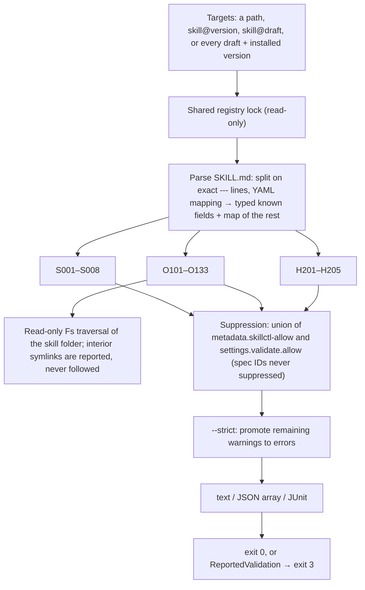

# Validation

The validator is native Rust. Rules are grouped into the Agent Skills **spec** (S), **organisation** quality rules (O) and **harness compatibility** (H). Each rule has a stable ID, a default severity and a short fix hint, so output can be filtered and CI can depend on IDs. Harnesses run skill scripts; skillctl only lints them and never executes anything bundled in a skill.

## Pipeline



- Structural prerequisites short-circuit: a missing `SKILL.md` or malformed frontmatter yields only its own finding (S001/S002) instead of a cascade.
- Field-level findings accumulate, so one run reports every problem.
- `validate::run` is the spec-only API used where only structural validity matters; `validate::run_all` composes all groups and applies suppression and strict policy. `seal` calls the same full runner with the registry allow-list before staging, so a sealed version can never contain unsuppressed errors.
- Filesystem failures propagate as `Error::Io`, separately from findings.

## Rule engine

```rust
pub enum Severity { Warning, Error }

pub struct Finding { rule: &'static str, severity: Severity, path: PathBuf, line: Option<usize>, message: String, hint: &'static str }

pub trait Rule {
    fn id(&self) -> &'static str;
    fn check(&self, skill: &ParsedSkill, findings: &mut Vec<Finding>);
    fn check_fs(&self, fs: &dyn Fs, skill: &ParsedSkill, findings: &mut Vec<Finding>) -> Result<(), Error> { Ok(()) }
}
```

`check` covers pure rules over the parsed document; `check_fs` is a default-empty extension for rules that must inspect bundled files through the injectable `Fs`, so adding filesystem-aware rules did not change existing implementations. Resource references are extracted with a CommonMark parser (`pulldown-cmark`); script and secret lints use precompiled regular expressions.

## Spec rules (always errors, never suppressible)

| ID | Check |
|---|---|
| S001 | `SKILL.md` exists at the skill folder root |
| S002 | Frontmatter is present and parses as a YAML mapping |
| S003 | `name` is present, 1–64 characters, matches `^[a-z0-9]+(-[a-z0-9]+)*$` |
| S004 | `name` equals the skill folder's name |
| S005 | `description` is present, non-empty, at most 1,024 characters |
| S006 | `compatibility`, if present, is 1–500 characters |
| S007 | `metadata`, if present, maps strings to strings |
| S008 | `license` and `allowed-tools`, if present, are strings |

## Organisation rules

| ID | Severity | Check |
|---|---|---|
| O101 | error | `metadata.version` is present and parses as semver |
| O102 | warning | `description` is at least 80 characters |
| O103 | warning | `description` contains a "use when" clause (case-insensitive) |
| O104 | error | `description` contains no `<` or `>` |
| O110 | warning | Body is at most 500 lines |
| O111 | warning | Body is at most 5,000 estimated tokens (Unicode characters ÷ 4) |
| O112 | warning | Each file in `references/` is at most 10,000 estimated tokens |
| O120 | error | Every relative path the body references (CommonMark links, images, reference links, and backtick paths starting with `scripts/`, `references/` or `assets/`) exists |
| O121 | warning | Every file under `scripts/`, `references/`, `assets/` is referenced at least once |
| O122 | error | No symlinks inside the skill folder |
| O123 | error | No reference escapes the skill folder (`..`, including percent-encoded traversal) |
| O130 | error | Each file in `scripts/` has a shebang line and the executable bit |
| O131 | warning | Scripts contain no interactive input (`read -p`, `read -r` from a terminal, Python `input()`) |
| O132 | error | Scripts contain no `curl … \| sh`, `wget … \| sh` or `sudo` |
| O133 | error | No likely secrets: private key headers, AWS-style access keys, tokens with common provider prefixes. Findings name the path and line but never echo the matched value. |

The O13x rules are static heuristics, not a sandbox or an exhaustive security audit.

## Harness compatibility rules (warnings)

Known-field lists live in `validate/fields.rs`, so updating them for a new harness release is a one-file change.

| ID | Check |
|---|---|
| H201 | Frontmatter fields that only Claude Code acts on (`context`, `agent`, `hooks`, `model`, `effort`, `shell`, `argument-hint`, `arguments`) are flagged with "other harnesses ignore this" |
| H202 | `allowed-tools` is set; support varies by harness and it pre-approves tools |
| H203 | The body uses Claude Code substitutions (`${CLAUDE_SKILL_DIR}`, `$ARGUMENTS`, `` !`command` `` injection), which other harnesses show as plain text |
| H204 | `context: fork` is combined with instructions to ask the user, which cannot work in a Claude Code subagent |
| H205 | Unknown frontmatter fields not in any harness's known list |

## Suppression and strict mode

- Per skill: `metadata.skillctl-allow: "O102,H201"` in the frontmatter.
- Everywhere: `settings.validate.allow: [O102, H201]` in the registry.
- The two lists are unioned. Spec IDs in either list are ignored.
- `--strict` runs **after** suppression, so an allowed warning is not promoted.

## Reports

| Format | Shape |
|---|---|
| text (default) | One line per finding, `path:line ID severity message`, followed by an indented hint line, then a summary count. Hidden by `--quiet`. |
| json | One JSON array of findings with `rule`, `severity`, `path`, `line`, `message`, `hint`. Preserved under `--quiet`. |
| junit | One `<testcase>` per skill, including passing skills; one `<failure>` element per error with escaped location and hint; the full text report in `<system-out>`. Intended for GitLab's `artifacts:reports:junit` merge-request widget. |

`--format` overrides the global `--json` flag. On errors the command writes the complete document first and then returns `Error::ReportedValidation`; the binary maps that to exit 3 without appending a second JSON object or corrupting the XML. JUnit uses `quick-junit` for XML string sanitisation plus a small renderer, because `quick-junit`'s single-status testcase model cannot express several failure elements per skill.

## Reference validator

`--with-reference` runs `skills-ref validate <directory>` when that executable is on `PATH`, directly and without a shell. A missing tool is not an error. A failed external verdict is merged as error `R001` alongside the native findings; the raw external output is not copied into reports because its format is not stable and it may disclose secrets. This guards against the native rules drifting from the published specification.
